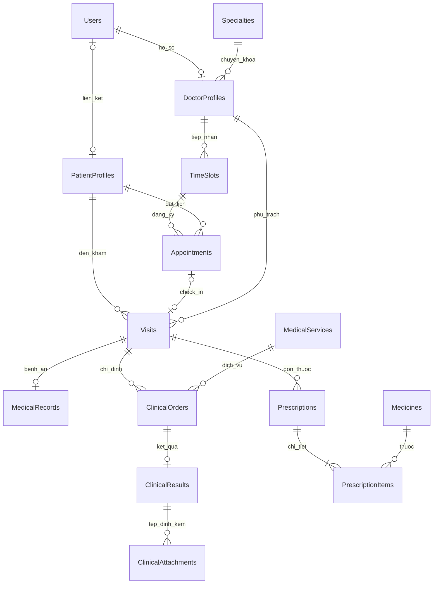
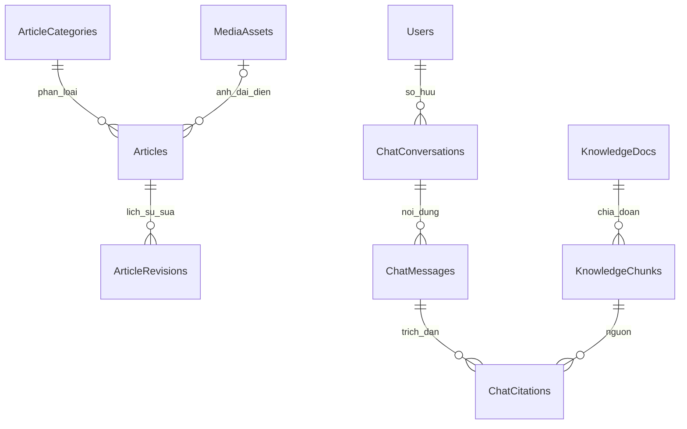

## 2.4. Thiết kế cơ sở dữ liệu

Cơ sở dữ liệu của SmartClinic được tổ chức theo các nhóm nghiệp vụ, bảo đảm liên kết xuyên suốt từ tiếp nhận bệnh nhân đến khám bệnh, trả kết quả và theo dõi lịch sử điều trị. SQL Server lưu dữ liệu có cấu trúc và các ràng buộc nghiệp vụ; Object Storage lưu tài liệu, hình ảnh và tệp kết quả; Pinecone lưu vector phục vụ truy xuất tri thức của trợ lý AI. Các thành phần liên kết thông qua mã định danh và thông tin mô tả được quản lý tại backend.

### 2.4.1. Xác định thực thể và mối quan hệ

Các thực thể được chia thành sáu nhóm chính:

| Nhóm thực thể | Thành phần | Vai trò |
|---|---|---|
| Tài khoản và hồ sơ | Users, RefreshTokens, PatientProfiles, DoctorProfiles | Quản lý danh tính đăng nhập, phiên truy cập và thông tin bệnh nhân, bác sĩ. |
| Danh mục và lịch khám | Specialties, ClinicRooms, MedicalServices, Medicines, DoctorSchedules, TimeSlots | Cung cấp dữ liệu dùng chung, lịch làm việc và khả năng tiếp nhận. |
| Tiếp đón và điều trị | Appointments, Visits, MedicalRecords, ClinicalOrders, ClinicalResults, ClinicalAttachments, DepartmentReferrals, Prescriptions, PrescriptionItems | Quản lý toàn bộ quá trình khám và kết quả điều trị. |
| Nội dung website | ArticleCategories, Articles, MediaAssets, ArticleRevisions | Phân loại, xuất bản và theo dõi thay đổi bài viết. |
| Tri thức và hội thoại AI | KnowledgeDocs, KnowledgeChunks, ChatConversations, ChatMessages, ChatCitations | Quản lý nguồn tri thức, hội thoại và căn cứ của câu trả lời. |
| Vận hành | Notifications, OutboxMessages, AuditLogs | Gửi thông báo, theo dõi sự kiện cần xử lý và ghi nhận thao tác. |

Trong nhóm nghiệp vụ khám bệnh, một bệnh nhân có nhiều lịch hẹn và nhiều lượt khám. Lịch hẹn biểu thị nhu cầu khám đã đăng ký; lượt khám biểu thị một lần tiếp nhận thực tế. Mỗi lịch hẹn phát sinh tối đa một lượt khám, trong khi lượt khám trực tiếp tại quầy có thể không liên kết lịch hẹn. Hồ sơ bệnh nhân có mã định danh riêng và có thể tồn tại trước khi bệnh nhân đăng ký tài khoản.

Một bác sĩ có nhiều khung giờ tiếp nhận và phụ trách nhiều lượt khám. Mỗi lượt khám gắn với một bác sĩ chính, tối đa một bệnh án và nhiều chỉ định, đơn thuốc hoặc yêu cầu chuyển chuyên khoa. Mỗi chỉ định có tối đa một bản kết quả tổng hợp; kết quả có thể kèm nhiều tệp. Một đơn thuốc gồm nhiều dòng thuốc, mỗi dòng tham chiếu danh mục thuốc và lưu thông tin sử dụng tại thời điểm kê đơn.

Đối với nội dung website, một chuyên mục chứa nhiều bài viết và một bài viết có nhiều phiên bản chỉnh sửa. Đối với trợ lý AI, một tài liệu có nhiều đoạn tri thức; một hội thoại có nhiều tin nhắn, mỗi tin nhắn trả lời có thể trích dẫn nhiều đoạn nguồn. Các quan hệ này giúp truy vết dữ liệu mà không phải sao chép toàn bộ nội dung giữa các bảng.

### 2.4.2. Biểu đồ thực thể liên kết

Biểu đồ được chia theo nhóm nghiệp vụ để hạn chế các đường nối giao nhau. Ký hiệu `||` biểu thị đúng một, `o|` biểu thị không hoặc một và `o{` biểu thị không hoặc nhiều.

**a. Nhóm hồ sơ và khám bệnh**

**b. Nhóm bài viết và tri thức AI**

Đây là các quan hệ cốt lõi. Các liên kết đến người tạo, người cập nhật, người duyệt và bảng vận hành được trình bày trong phần thiết kế bảng để giữ sơ đồ dễ đọc. Quan hệ đơn thuốc có ít nhất một dòng thuốc được kiểm tra khi phát hành; riêng khóa ngoại không bảo đảm được điều kiện này.

### 2.4.3. Thiết kế chi tiết các bảng dữ liệu

Trong các bảng dưới đây, **PK** là khóa chính, **FK** là khóa ngoại và dấu **?** biểu thị thuộc tính được phép để trống. Khóa nghiệp vụ chính sử dụng `uniqueidentifier`; danh mục có thể dùng `int`. Chuỗi tiếng Việt sử dụng `nvarchar`, thời gian sử dụng `datetime2` theo UTC, giá trị đo và tiền sử dụng `decimal`, trạng thái logic sử dụng `bit`. Các thuộc tính cùng nhóm được trình bày chung để rút gọn mô tả.

**a. Tài khoản và hồ sơ**

| Bảng | Thuộc tính chính và ý nghĩa |
|---|---|
| **Users** — tài khoản truy cập | `Id` (PK): mã tài khoản; `Email`, `PhoneNumber`: thông tin liên hệ; `PasswordHash`: mật khẩu đã băm; `Role`: vai trò truy cập; `IsActive`: trạng thái sử dụng; `CreatedAtUtc`: ngày tạo. |
| **RefreshTokens** — duy trì phiên đăng nhập | `Id` (PK); `UserId` (FK): chủ phiên; `TokenHash`: giá trị băm token; `ExpiresAtUtc`: hạn sử dụng; `RevokedAtUtc?`: thời điểm thu hồi; `CreatedAtUtc`: thời điểm cấp. |
| **PatientProfiles** — hồ sơ bệnh nhân | `Id` (PK), `PatientCode`: mã hồ sơ duy nhất; `UserId?` (FK): tài khoản liên kết; `FullName`, `DOB`, `Gender`: nhân thân; `PhoneNumber`, `Address`: liên hệ; `IdentityCard?`, `HealthInsuranceNumber?`, `HealthInsuranceExpiry?`: CCCD và BHYT; `Occupation?`, `Ethnicity?`, `AvatarUrl?`: thông tin bổ sung; `EmergencyContactName?`, `EmergencyContactPhone?`: liên hệ khẩn cấp; `BloodType?`, `Allergies?`, `BackgroundDisease?`: tiền sử sức khỏe; `HeightCm?`, `WeightKg?`: số đo tham khảo. |
| **DoctorProfiles** — hồ sơ chuyên môn | `UserId` (PK, FK): tài khoản bác sĩ; `SpecialtyId` (FK): chuyên khoa; `Bio?`: giới thiệu chuyên môn; `ConsultationFee`: phí khám. |

Số đo trong hồ sơ là thông tin tham khảo; chỉ số ghi nhận trong từng lần khám được lưu tại bệnh án. Hồ sơ hoàn thiện phải có họ tên, ngày sinh, giới tính, số điện thoại, địa chỉ và ít nhất một trong hai thông tin CCCD hoặc BHYT. Số điện thoại không được dùng làm khóa duy nhất vì nhiều bệnh nhân có thể dùng chung số liên hệ.

**b. Danh mục và tổ chức lịch khám**

| Bảng | Thuộc tính chính và ý nghĩa |
|---|---|
| **Specialties** — danh mục chuyên khoa | `Id` (PK); `Name`: tên chuyên khoa; `Description?`: mô tả; `IsActive`: trạng thái hoạt động. |
| **ClinicRooms** — danh mục phòng | `Id` (PK); `SpecialtyId` (FK); `Name`, `Location`: tên và vị trí phòng; `IsActive`: trạng thái sử dụng. |
| **MedicalServices** — dịch vụ khám, xét nghiệm | `Id` (PK); `SpecialtyId` (FK); `Name`, `ServiceType`: tên và loại dịch vụ; `Price`: đơn giá; `IsActive`: trạng thái cung cấp. |
| **Medicines** — danh mục thuốc | `Id` (PK); `Name`, `ActiveIngredient`, `Strength`, `DosageForm`, `Unit`: tên thuốc, hoạt chất, hàm lượng, dạng bào chế và đơn vị; `IsActive`: trạng thái sử dụng. |
| **DoctorSchedules** — lịch làm việc | `Id` (PK); `DoctorId` (FK), `ClinicRoomId` (FK): bác sĩ và phòng; `StartTime`, `EndTime`: thời gian làm việc; `Status`: trạng thái lịch. |
| **TimeSlots** — khung giờ đặt khám | `Id` (PK); `ScheduleId`, `DoctorId` (FK): lịch và bác sĩ; `StartTime`, `EndTime`: khoảng tiếp nhận; `MaxCapacity`, `ReservedCount`: sức chứa và số chỗ đã giữ; `RowVersion`: kiểm soát cập nhật đồng thời. |
| **Appointments** — lịch hẹn | `Id` (PK); `PatientProfileId`, `TimeSlotId` (FK); `Symptom?`: lý do khám; `Status`: trạng thái lịch hẹn; `CreatedAtUtc`: thời điểm đăng ký. |

**c. Lượt khám và dữ liệu chuyên môn**

| Bảng | Thuộc tính chính và ý nghĩa |
|---|---|
| **Visits** — lần tiếp nhận thực tế | `Id` (PK); `PatientProfileId` (FK); `AppointmentId?` (FK): lịch hẹn liên quan; `PrimaryDoctorId`, `ClinicRoomId` (FK): bác sĩ chính và phòng; `QueueNumber`, `VisitDate`: số thứ tự và ngày khám; `Status`, `CheckedInAtUtc`, `CompletedAtUtc?`: trạng thái và thời điểm xử lý. |
| **MedicalRecords** — bệnh án của lượt khám | `Id` (PK); `VisitId` (FK, duy nhất); `Symptoms`, `ClinicalNotes?`: triệu chứng và diễn biến; `HeightCm?`, `WeightKg?`, `Temperature?`, `Pulse?`, `SystolicBP?`, `DiastolicBP?`: chỉ số tại lần khám; `Diagnosis`, `TreatmentPlan`, `Advice?`, `FollowUpDate?`: chẩn đoán, xử trí, lời dặn và ngày tái khám. |
| **ClinicalOrders** — phiếu chỉ định | `Id` (PK); `VisitId`, `MedicalServiceId`, `RequestingDoctorId` (FK): lượt khám, dịch vụ và người chỉ định; `AssignedDoctorId?` (FK): người thực hiện; `Reason?`, `Status`, `RequestedAtUtc`: lý do, trạng thái và ngày chỉ định. |
| **ClinicalResults** — kết quả chuyên môn | `Id` (PK); `ClinicalOrderId` (FK, duy nhất); `PerformedByUserId` (FK): người ghi kết quả; `Findings`, `Conclusion`: nội dung và kết luận; `CompletedAtUtc`: thời điểm hoàn thành. |
| **ClinicalAttachments** — tệp kết quả | `Id` (PK); `ClinicalResultId` (FK); `StorageKey`: định danh tệp trong kho; `OriginalFileName`, `ContentType`, `SizeBytes`: tên, định dạng và dung lượng; `CreatedAtUtc`: ngày lưu. |
| **DepartmentReferrals** — chuyển chuyên khoa | `Id` (PK); `VisitId`, `RequestingDoctorId`, `TargetSpecialtyId` (FK); `ReceivingDoctorId?` (FK): bác sĩ tiếp nhận; `Reason`, `Status`, `CreatedAtUtc`: lý do, trạng thái và thời điểm chuyển. |
| **Prescriptions** — đơn thuốc | `Id` (PK); `VisitId`, `PrescribedByDoctorId` (FK); `Status`: trạng thái đơn; `Notes?`: hướng dẫn chung; `CreatedAtUtc`, `IssuedAtUtc?`: thời điểm tạo và phát hành. |
| **PrescriptionItems** — chi tiết đơn thuốc | `Id` (PK); `PrescriptionId`, `MedicineId` (FK); `MedicineName`, `Strength`, `Unit`: thông tin thuốc tại thời điểm kê; `Dose`, `Route`, `Frequency`, `DurationDays`, `Quantity`, `Instructions?`: liều, đường dùng, tần suất, thời gian, số lượng và hướng dẫn. |

**d. Bài viết và tài nguyên nội dung**

| Bảng | Thuộc tính chính và ý nghĩa |
|---|---|
| **ArticleCategories** — chuyên mục | `Id` (PK); `Name`, `Slug`, `Description?`: tên, đường dẫn và mô tả; `SortOrder`, `IsActive`, `CreatedAtUtc`: thứ tự, trạng thái và ngày tạo. |
| **Articles** — bài viết | `Id` (PK); `CategoryId`, `CoverMediaId?` (FK): chuyên mục và ảnh bìa; `Title`, `Slug`, `Summary?`, `ContentHtml?`: nội dung; `AuthorDisplayName?`: tên tác giả hiển thị; `Status`, `IsFeatured`, `ViewsCount`: trạng thái, nổi bật và lượt xem; `SeoTitle?`, `SeoDescription?`: thông tin tìm kiếm; `CreatedByUserId`, `UpdatedByUserId?`, `PublishedByUserId?` (FK): người thao tác; `CreatedAtUtc`, `UpdatedAtUtc?`, `PublishedAtUtc?`: thời điểm tương ứng; `RowVersion`: chống ghi đè đồng thời. |
| **MediaAssets** — tài nguyên bài viết | `Id` (PK); `StorageKey`, `OriginalFileName`, `ContentType`, `SizeBytes`: thông tin tệp; `AltText?`: mô tả ảnh; `UploadedByUserId` (FK), `CreatedAtUtc`: người tải và ngày tạo. |
| **ArticleRevisions** — lịch sử biên tập | `Id` (PK); `ArticleId` (FK); `RevisionNumber`: số phiên bản; `SnapshotJson`: bản chụp nội dung; `ChangedByUserId` (FK), `ChangedAtUtc`, `ChangeNote?`: người sửa, thời gian và ghi chú. |

**e. Tri thức AI và vận hành**

| Bảng | Thuộc tính chính và ý nghĩa |
|---|---|
| **KnowledgeDocs** — tài liệu nguồn | `Id` (PK); `Title`, `Source`, `Version`, `StorageKey`: tên, nguồn, phiên bản và tệp; `ApprovalStatus`, `IndexStatus`, `IsActive`: trạng thái duyệt, lập chỉ mục và hiệu lực; `UploadedByUserId`, `ApprovedByUserId?` (FK), `UploadedAtUtc`: thông tin quản lý. Mỗi phiên bản tài liệu được lưu bằng một bản ghi riêng. |
| **KnowledgeChunks** — đoạn tri thức | `Id` (PK); `KnowledgeDocId` (FK); `ChunkIndex`, `Content`, `PageNumber?`, `SectionTitle?`: thứ tự, nội dung và vị trí nguồn; `VectorId?`, `EmbeddingModel?`: liên kết vector và mô hình mã hóa. |
| **ChatConversations** — phiên hội thoại | `Id` (PK); `UserId` (FK); `Title?`, `CreatedAtUtc`, `UpdatedAtUtc`: tiêu đề và thời gian hoạt động. |
| **ChatMessages** — tin nhắn | `Id` (PK); `ConversationId` (FK); `SenderRole`, `Content`, `CreatedAtUtc`: bên gửi, nội dung và thời điểm gửi. |
| **ChatCitations** — nguồn câu trả lời | `Id` (PK); `MessageId`, `KnowledgeChunkId` (FK); `CitationOrder`: thứ tự trích dẫn. Phiên bản và vị trí nguồn được truy ra từ đoạn tri thức cùng tài liệu liên quan. |
| **Notifications** — thông báo người dùng | `Id` (PK); `UserId` (FK); `Title`, `Message`, `IsRead`, `CreatedAtUtc`: nội dung, trạng thái đọc và thời điểm tạo. |
| **OutboxMessages** — sự kiện chờ xử lý | `Id` (PK); `EventType`, `PayloadJson`: loại sự kiện và dữ liệu; `CreatedAtUtc`, `ProcessedAtUtc?`, `RetryCount`: thời điểm tạo, xử lý và số lần thử lại. |
| **AuditLogs** — nhật ký thao tác | `Id` (PK); `ActorUserId?` (FK): người thực hiện; `Action`, `EntityType`, `EntityId`: thao tác và đối tượng; `OccurredAtUtc`, `Result`: thời gian và kết quả. |

**Các ràng buộc toàn vẹn chính.** Email tài khoản, mã bệnh nhân và slug trong từng bảng nội dung được kiểm soát duy nhất. `PatientProfiles.UserId` và `Visits.AppointmentId` sử dụng chỉ mục duy nhất có điều kiện khi khác `NULL`, bảo đảm hồ sơ chưa liên kết tài khoản và lượt khám trực tiếp vẫn được lưu hợp lệ. `MedicalRecords.VisitId` và `ClinicalResults.ClinicalOrderId` được đặt duy nhất để bảo đảm quan hệ một–một. Số thứ tự khám được kiểm soát theo phòng và ngày; số chỗ giữ phải nằm trong sức chứa khung giờ. Backend cập nhật lịch hẹn và số chỗ trong cùng giao dịch, đồng thời kiểm tra bác sĩ của khung giờ phù hợp với lịch làm việc.

Dữ liệu khám bệnh được kiểm soát quyền truy cập theo vai trò và phạm vi phụ trách. Các bản ghi đã phát hành được lưu lịch sử khi điều chỉnh, hạn chế xóa dây chuyền làm mất dấu vết. Tệp chuyên môn chỉ lưu định danh tại SQL Server và được cấp đường dẫn truy cập có thời hạn sau khi kiểm tra quyền. Kho vector dùng chung chỉ chứa tri thức đã được phê duyệt, không chứa hồ sơ bệnh nhân hoặc nội dung hội thoại cá nhân.
