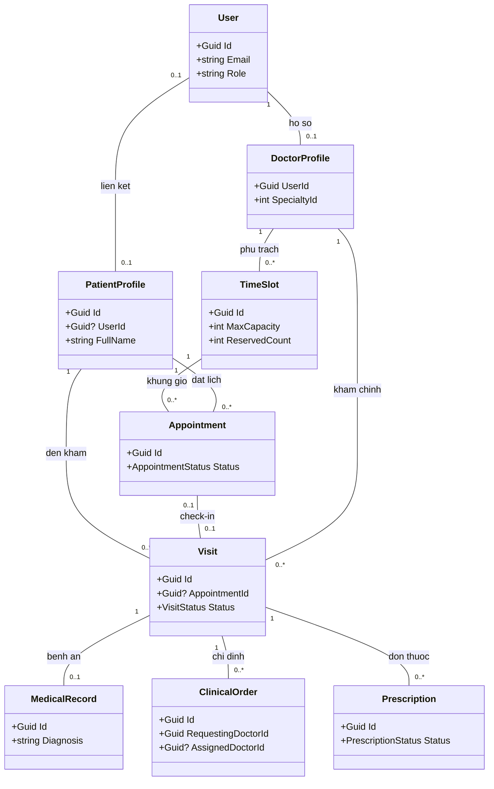
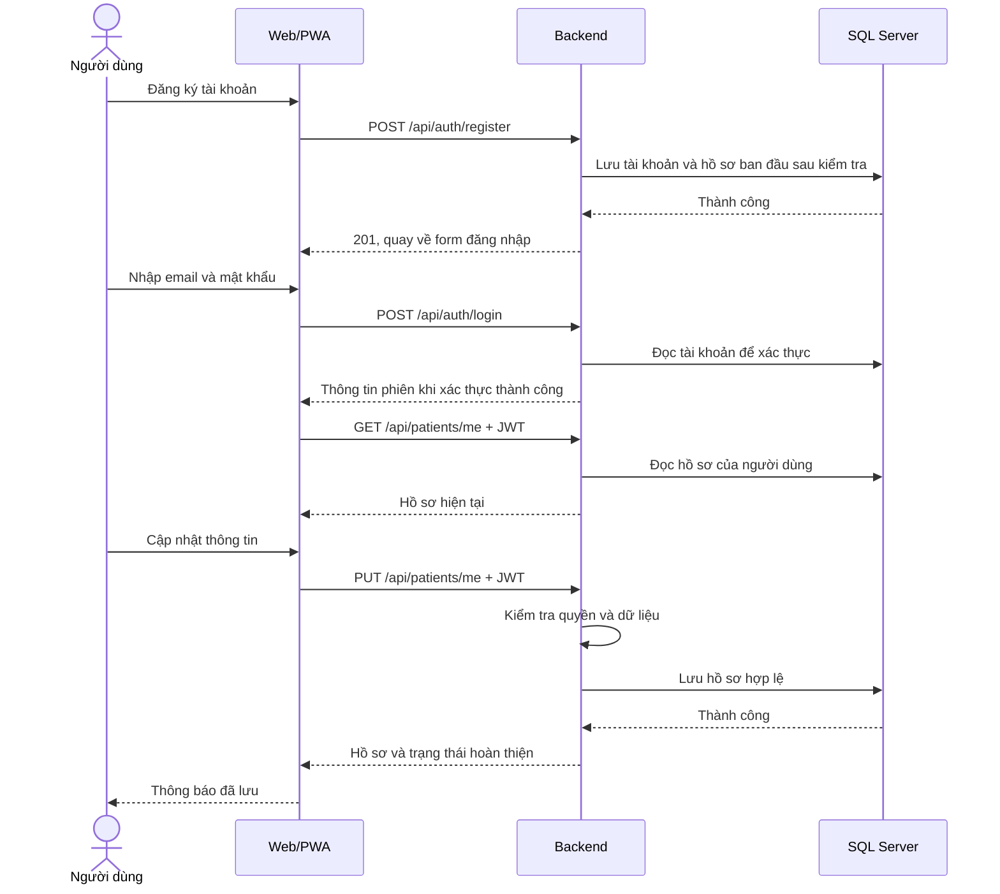
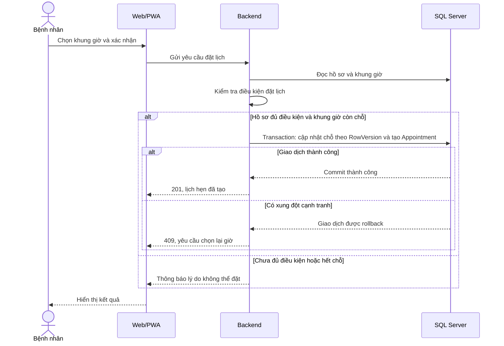
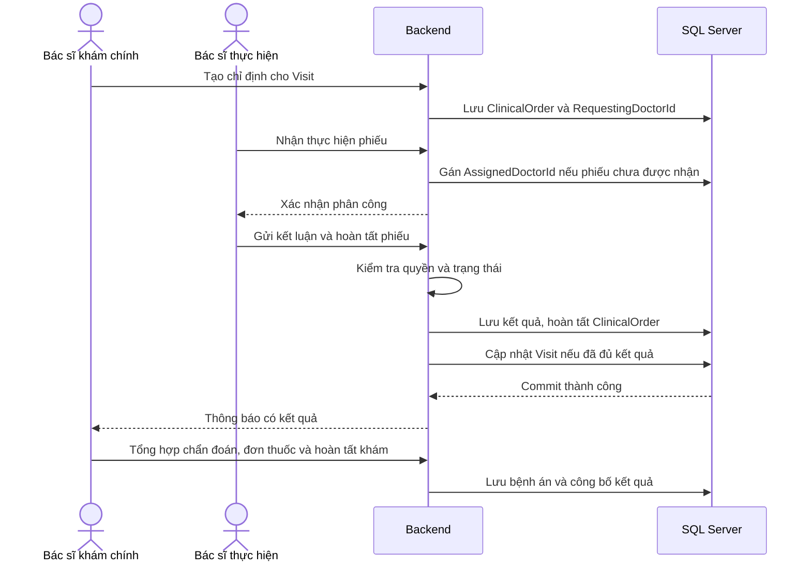
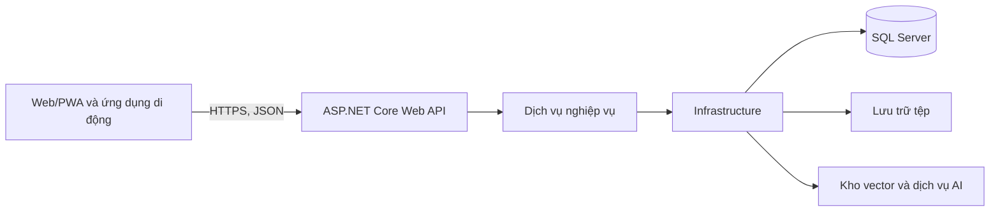
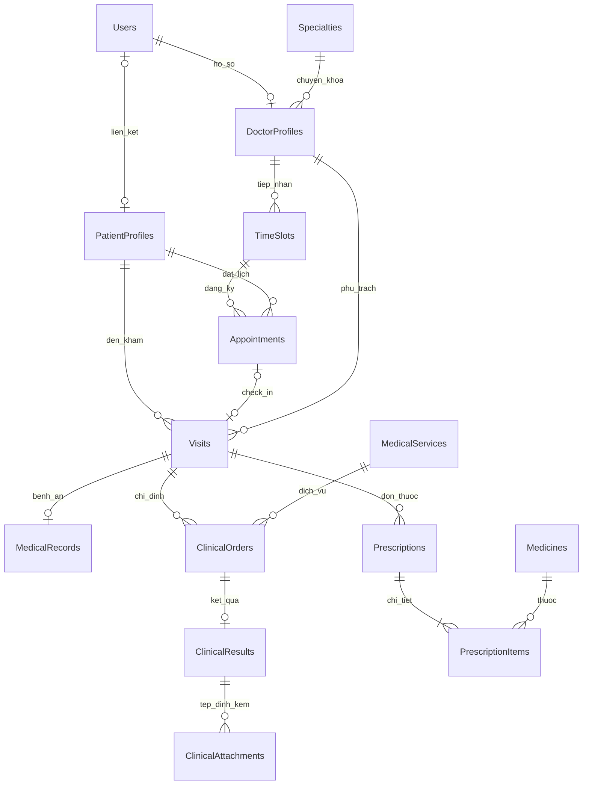
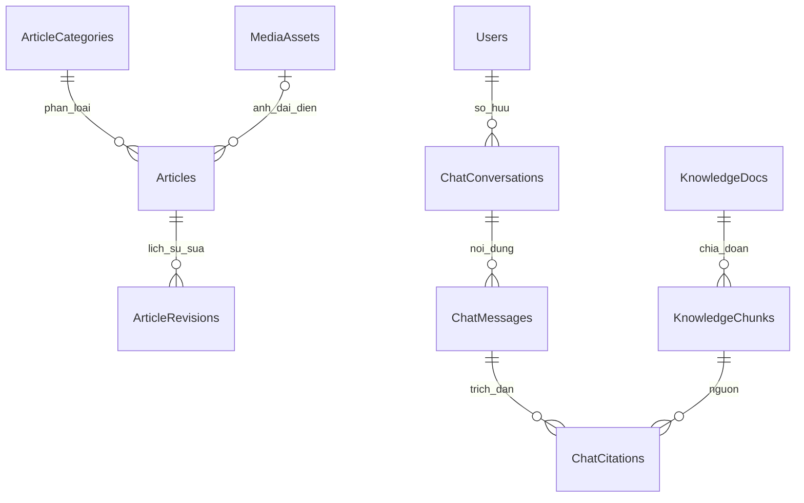

# Thiết kế chức năng và giao tiếp của hệ thống SmartClinic

## 2.3.2. Thiết kế các module chức năng

### a. Nguyên tắc phân chia module

Hệ thống SmartClinic được thiết kế nhằm hỗ trợ quy trình quản lý phòng khám ngoại trú, từ cung cấp thông tin, đăng ký tài khoản, khai báo hồ sơ, đặt lịch và tiếp đón đến khám bệnh, thực hiện chỉ định, trả kết quả và theo dõi sau khám. Các chức năng được phân chia thành những module có trách nhiệm rõ ràng, liên kết với nhau thông qua các đối tượng nghiệp vụ và các giao diện dịch vụ. Cách tổ chức này giúp hạn chế sự phụ thuộc giữa các chức năng, tạo điều kiện mở rộng hệ thống và kiểm thử từng phần độc lập.

Về kiến trúc, hệ thống sử dụng mô hình Client–Server. Giao diện Web/PWA được xây dựng bằng React và Vite; Zustand quản lý trạng thái phía giao diện, còn Axios đảm nhiệm giao tiếp HTTP với máy chủ. Ứng dụng di động dành cho bệnh nhân sử dụng chung hợp đồng API với Web/PWA, bảo đảm thống nhất dữ liệu hồ sơ, lịch hẹn và kết quả khám trên các nền tảng. Backend sử dụng ASP.NET Core Web API và tổ chức thành bốn tầng Domain, Application, Infrastructure và API theo định hướng Clean Architecture. Dữ liệu giao dịch được quản lý tập trung bằng SQL Server; kho vector và dịch vụ mô hình ngôn ngữ thuộc phân hệ trợ lý AI trong thiết kế tổng thể.

Các module phối hợp trên cơ sở dữ liệu tập trung và các quy tắc nghiệp vụ thống nhất. Mỗi module tiếp nhận dữ liệu từ những thành phần liên quan, xử lý trong phạm vi trách nhiệm và cung cấp kết quả cho các bước tiếp theo. Nhờ đó, thông tin của bệnh nhân được duy trì liên tục từ khi đăng ký đến khi hoàn tất lượt khám.

### b. Module tài khoản, xác thực và phân quyền

Module tài khoản quản lý danh tính truy cập của người dùng, bao gồm đăng ký, đăng nhập, lấy thông tin tài khoản hiện tại và kết thúc phiên trên thiết bị. Tài khoản đăng ký công khai được gán vai trò bệnh nhân; các vai trò nhân sự phải được cấp thông qua quy trình quản trị phù hợp. Người dùng đăng nhập bằng email và mật khẩu. Sau khi đăng ký thành công, giao diện quay về biểu mẫu đăng nhập để người dùng chủ động xác thực tài khoản vừa tạo.

Quá trình đăng ký kiểm tra tính hợp lệ của email, số điện thoại, mật khẩu và mật khẩu xác nhận. Mật khẩu được băm bằng dịch vụ PasswordHasher trước khi lưu. Khi đăng nhập thành công, backend cấp access token JWT chứa định danh và vai trò người dùng. Những yêu cầu truy cập tài nguyên được bảo vệ phải gửi token trong tiêu đề Authorization. Trạng thái đăng nhập trên giao diện chỉ phục vụ trải nghiệm sử dụng; quyết định cho phép truy cập thuộc trách nhiệm của backend.

Thiết kế tổng thể phân biệt khách vãng lai, bệnh nhân, lễ tân, bác sĩ và quản trị viên. Quyền theo vai trò được kết hợp với quyền trên từng bản ghi: bệnh nhân chỉ được truy cập hồ sơ của mình; bác sĩ chỉ được thao tác trong ca khám hoặc phiếu chỉ định được phân công; lễ tân sử dụng thông tin hành chính trong phạm vi tiếp đón. Các vai trò Patient, Receptionist, Doctor và Admin được quản lý thống nhất ở backend. Quản trị viên có quyền quản lý tài khoản và phân công vai trò; khách vãng lai chỉ sử dụng các chức năng công khai. Phiên đăng nhập sử dụng access token ngắn hạn kết hợp refresh token được luân chuyển và kiểm soát thu hồi. Thao tác đăng xuất vô hiệu hóa phiên tương ứng; các thay đổi quyền truy cập được kiểm tra thông qua trạng thái phiên phía máy chủ.

### c. Module hồ sơ bệnh nhân và hoàn thiện thông tin cá nhân

Module hồ sơ bệnh nhân quản lý thông tin hành chính và sức khỏe nền dùng xuyên suốt quá trình khám chữa bệnh. Thông tin hành chính gồm họ tên, ngày sinh, giới tính, số điện thoại, địa chỉ và giấy tờ định danh. Theo quy tắc đã xác định, hồ sơ hoàn thiện phải có ít nhất một trong hai thông tin CCCD hoặc BHYT, cùng các trường hành chính bắt buộc. Thông tin sức khỏe nền gồm nhóm máu, tiền sử dị ứng, bệnh nền, chiều cao và cân nặng tham khảo; các trường này được phép chưa khai báo khi người dùng chưa có thông tin.

Giao diện cung cấp biểu mẫu đọc và cập nhật hồ sơ. Backend xác định tài khoản từ JWT, kiểm tra dữ liệu đầu vào, cập nhật hồ sơ tương ứng và trả về trạng thái hoàn thiện. Người dùng không được gửi một định danh bệnh nhân tùy ý để sửa hồ sơ khác. Trạng thái hoàn thiện được tính tại tầng Application và phản hồi cho giao diện, không được quyết định chỉ bằng một cờ do frontend gửi lên.

Hồ sơ bệnh nhân được tách khỏi tài khoản đăng nhập để hỗ trợ khách đến trực tiếp tại quầy. Một hồ sơ có thể tồn tại trước khi được liên kết với tài khoản. Việc liên kết sau này phải dựa trên xác minh phù hợp; số điện thoại hoặc mã bệnh nhân riêng lẻ chỉ là thông tin tra cứu, không đủ để tự động cấp quyền xem toàn bộ lịch sử y tế. PatientProfile sử dụng mã hồ sơ độc lập và liên kết tùy chọn với User. Toàn bộ lịch sử khám tham chiếu đến mã hồ sơ, nhờ đó việc liên kết tài khoản không làm thay đổi hoặc sao chép các kết quả đã lưu.

### d. Module danh mục và thông tin công khai

Module danh mục cung cấp dữ liệu nền cho toàn hệ thống, bao gồm chuyên khoa, bác sĩ, phòng khám, dịch vụ y tế, thuốc và thông tin hoạt động của cơ sở. Quản trị viên chịu trách nhiệm cập nhật danh mục; các module đặt lịch, tiếp đón và khám bệnh sử dụng những định danh thống nhất từ module này.

Cổng thông tin công khai cho phép khách chưa đăng nhập xem giới thiệu phòng khám, danh sách chuyên khoa, thông tin bác sĩ, giờ hoạt động và bảng giá dịch vụ. Những dữ liệu ít thay đổi có thể được lưu đệm để giảm số lần truy vấn, nhưng phải được làm mới khi quản trị viên cập nhật. Các danh mục đã được sử dụng trong lịch hẹn, bệnh án hoặc đơn thuốc cần được ngừng hoạt động theo quy tắc nghiệp vụ thay vì xóa tùy ý làm mất khả năng truy nguyên dữ liệu.

### e. Module lịch làm việc và đặt lịch khám

Module lịch làm việc quản lý thời gian nhận khám của bác sĩ, phòng được phân công, ngày nghỉ và các khung giờ có thể đặt. Mỗi khung giờ xác định thời điểm bắt đầu, kết thúc và công suất tiếp nhận. Việc tạo lịch cần kiểm tra chồng lấn thời gian và sự phù hợp giữa bác sĩ, phòng khám và chuyên khoa.

Module đặt lịch cho phép bệnh nhân lựa chọn chuyên khoa, bác sĩ, ngày khám và khung giờ còn chỗ; lễ tân có thể thực hiện đặt hộ theo quyền được cấp. Trước khi tạo lịch hẹn cho bệnh nhân, backend kiểm tra trạng thái hoàn thiện hồ sơ và điều kiện nhận khám. Các thao tác đặt, đổi và hủy lịch phải cập nhật đồng thời lịch hẹn và số chỗ của khung giờ trong một giao dịch.

Thiết kế sử dụng RowVersion kết hợp kiểm tra sức chứa để xử lý trường hợp nhiều yêu cầu cùng tranh chỗ cuối. Khi có xung đột, giao dịch không được lưu một phần; hệ thống trả kết quả yêu cầu chọn lại khung giờ hoặc tải lại dữ liệu. RowVersion chỉ phát huy tác dụng khi bản ghi khung giờ được cập nhật trong giao dịch đặt lịch. Việc chỉ thêm lịch hẹn mà không cập nhật khung giờ không đủ để ngăn đặt vượt công suất.

### f. Module tiếp đón, lượt khám và hàng chờ

Module tiếp đón phục vụ lễ tân trong việc xác nhận bệnh nhân đến khám, tra cứu hoặc tạo hồ sơ hành chính và đưa bệnh nhân vào hàng chờ. Hệ thống phân biệt Appointment, phản ánh việc đặt hẹn từ trước, với Visit, phản ánh một lượt khám thực tế tại cơ sở.

Đối với bệnh nhân có lịch hẹn, thao tác check-in xác nhận lịch hẹn đã đến và tạo Visit liên kết với Appointment. Đối với khách walk-in, lễ tân chọn hồ sơ có sẵn hoặc tạo hồ sơ mới, sau đó tạo Visit với AppointmentId để trống. Cả hai trường hợp đều sử dụng chung cấu trúc lượt khám, bệnh án, chỉ định và đơn thuốc ở các bước tiếp theo.

Hàng chờ được tổ chức theo phòng hoặc bác sĩ phụ trách, bao gồm số thứ tự, thời gian đến và trạng thái tiếp nhận. Yêu cầu check-in gửi lặp không được tạo hai lượt khám cho cùng một lịch hẹn. Dữ liệu trả cho lễ tân được giới hạn theo mục đích tiếp đón, không chứa toàn bộ nội dung chẩn đoán và ghi chú chuyên môn.

### g. Module khám bệnh và bệnh án điện tử

Module khám bệnh cung cấp không gian làm việc cho bác sĩ khám chính. Bác sĩ tiếp nhận lượt khám được phân công, xem thông tin nền cần thiết, ghi nhận triệu chứng, chỉ số sinh tồn, diễn biến khám và chẩn đoán. Các thông tin của một lần khám được gắn với Visit để bảo đảm khả năng truy nguyên và phân biệt với hồ sơ sức khỏe nền của bệnh nhân.

MedicalRecord lưu nội dung bệnh án chính của lượt khám. Thiết kế quy định mỗi Visit có tối đa một bệnh án chính và phải có bệnh án hợp lệ trước khi hoàn tất. Khi bác sĩ xác nhận kết thúc lượt khám, hệ thống công bố các tài liệu được phép trả cho bệnh nhân. Nội dung đã hoàn tất được khóa đối với thao tác sửa thông thường; việc hiệu chỉnh cần đi qua quy trình bổ sung có lý do và lưu lịch sử thay đổi.

### h. Module cận lâm sàng và phối hợp liên chuyên khoa

Module này quản lý các phiếu chỉ định phát sinh trong quá trình khám, chẳng hạn xét nghiệm, chẩn đoán hình ảnh hoặc thăm dò chức năng. Mỗi ClinicalOrder liên kết với Visit, dịch vụ được chỉ định, bác sĩ yêu cầu và bác sĩ thực hiện. Trường RequestingDoctorId xác định nơi tiếp nhận kết quả, còn AssignedDoctorId xác định người chịu trách nhiệm thực hiện phiếu.

Khi khoa phối hợp tiếp nhận một phiếu, hệ thống gán người thực hiện bằng thao tác có kiểm soát cạnh tranh để tránh hai bác sĩ cùng nhận một công việc. Quyền đọc của người thực hiện được giới hạn theo ngữ cảnh chỉ định. Kết quả bao gồm kết luận chuyên môn và tệp đính kèm; metadata được lưu trong SQL Server, còn tệp gốc được quản lý tại vùng lưu trữ riêng tư.

Sau khi phiếu được hoàn tất, kết quả được trả về đúng bác sĩ yêu cầu. Hệ thống đánh giá các phiếu còn hiệu lực của lượt khám; khi tất cả kết quả bắt buộc đã có, Visit được chuyển sang trạng thái sẵn sàng gọi lại. Trường hợp cần phối hợp khám chuyên khoa hoặc đề nghị chuyển tuyến được quản lý bằng DepartmentReferral, tách biệt với phiếu xét nghiệm hoặc chụp chiếu.

### i. Module đơn thuốc và trả kết quả

Module đơn thuốc hỗ trợ bác sĩ lập đơn dựa trên danh mục thuốc, ghi rõ thuốc, hàm lượng, liều dùng, đường dùng, tần suất, số ngày và số lượng. Prescription lưu thông tin chung của đơn; PrescriptionItem lưu từng thuốc được kê. Các thông tin quan trọng tại thời điểm kê đơn cần được lưu lại để việc thay đổi danh mục thuốc sau này không làm thay đổi nội dung đơn đã phát hành.

Bệnh nhân có tài khoản được xem các kết quả đã công bố thuộc lượt khám của mình trên Web/PWA hoặc ứng dụng di động. Đối với walk-in, hệ thống hỗ trợ in phiếu khám, kết quả cận lâm sàng và đơn thuốc để bàn giao trực tiếp. Tra cứu bằng QR hoặc đường dẫn được thiết kế đi kèm cơ chế xác thực và thời hạn truy cập. Quyền in của lễ tân, nếu được cấp, là quyền tiếp cận tài liệu chuyên môn đã công bố và phải được ghi nhận; quyền này không bao gồm sửa hoặc duyệt nội dung chuyên môn.

### j. Module quản lý bài viết

Module quản lý bài viết cung cấp chức năng biên soạn và xuất bản thông tin trên cổng phòng khám. Quản trị viên có thể tạo chuyên mục, tải ảnh, soạn bản nháp, xem trước, xuất bản hoặc gỡ bài khỏi trang công khai. Nội dung bài gồm tiêu đề, mô tả ngắn, ảnh đại diện, nội dung chi tiết, thông tin tác giả và thời điểm đăng.

Articles lưu nội dung hiện hành; ArticleCategories phân loại bài viết; MediaAssets lưu metadata ảnh và tệp; ArticleRevisions lưu các phiên bản chỉnh sửa. Các tài khoản tạo, sửa và xuất bản được ghi nhận riêng để thể hiện trách nhiệm của từng thao tác. Nội dung HTML phải được kiểm tra và lọc ở backend trước khi phục vụ độc giả. API công khai chỉ trả các bài đáp ứng điều kiện xuất bản; việc có ảnh hoặc đánh dấu nổi bật không làm một bài nháp trở thành bài công khai.

Kho bài viết và kho tri thức AI có mục đích sử dụng khác nhau. Một bài đã đăng lên website chỉ được đưa vào nguồn tham chiếu cho AI khi đáp ứng quy trình kiểm duyệt tri thức tương ứng. Các thao tác lưu nội dung, ghi lịch sử và chuyển trạng thái xuất bản được thực hiện qua API quản trị, đồng thời cập nhật dữ liệu hiển thị trên cổng thông tin.

### k. Module kho tri thức và trợ lý AI sử dụng RAG

Module kho tri thức quản lý tài liệu nguồn, phiên bản, thông tin phê duyệt và hiệu lực sử dụng. Tài liệu được trích xuất thành các đoạn có thông tin trang hoặc mục, sau đó được nhúng và lập chỉ mục vào kho vector. Quá trình xử lý được tổ chức thành tác vụ có trạng thái để quản trị viên biết tài liệu đang chờ, đã hoàn tất hoặc gặp lỗi cần xử lý lại.

Trợ lý AI tiếp nhận câu hỏi và phân biệt nguồn dữ liệu cần sử dụng. Câu hỏi về kiến thức hoặc quy trình khám được xử lý bằng truy xuất tài liệu đã duyệt; câu hỏi về giá dịch vụ hoặc khung giờ còn trống được xử lý qua công cụ truy vấn dữ liệu nghiệp vụ hiện hành. Kết quả từ mô hình ngôn ngữ phải được kiểm soát trước khi trả về và kèm thông tin nguồn khi sử dụng tài liệu tham chiếu.

Trong trường hợp không có nguồn phù hợp, trợ lý phản hồi về giới hạn thông tin và hướng dẫn người dùng liên hệ hoặc đặt lịch khám. Những yêu cầu vượt phạm vi hỗ trợ, như yêu cầu tự kê đơn, không được biến thành hành động nghiệp vụ tự động. Việc đặt lịch, nếu được khởi tạo từ hội thoại, vẫn phải đi qua use case đặt lịch và được người dùng xác nhận.

### l. Module thông báo, thống kê và kiểm toán

Module thông báo truyền đạt các sự kiện như xác nhận lịch hẹn, thay đổi lịch, hoàn tất chỉ định và hoàn tất lượt khám. Thông báo thời gian thực giúp giao diện cập nhật nhanh, trong khi API truy vấn dữ liệu vẫn là nguồn xác định trạng thái chính thức. Khi mất kết nối, giao diện tải lại trạng thái từ backend thay vì suy luận từ các sự kiện có thể đã bỏ lỡ.

Module thống kê tổng hợp dữ liệu phục vụ quản trị, bao gồm số lịch hẹn, số lượt khám thực tế, trạng thái hàng chờ và mức độ sử dụng dịch vụ. Các chỉ số phải có định nghĩa rõ ràng, đặc biệt không đồng nhất lịch hẹn được tạo với lượt khám đã diễn ra. Module kiểm toán ghi nhận người thực hiện, thời gian, đối tượng và nội dung thay đổi đối với các thao tác nhạy cảm. Cơ chế bảo vệ nhật ký phải được thiết kế cùng quyền truy cập database; việc sử dụng interceptor để ghi log riêng lẻ không tự bảo đảm tính bất biến.

### m. Quan hệ phụ thuộc giữa các module

| Module | Dữ liệu hoặc dịch vụ đầu vào | Kết quả cung cấp cho module khác |
|---|---|---|
| Tài khoản và phân quyền | Thông tin đăng ký, thông tin đăng nhập | Danh tính và quyền người thao tác |
| Hồ sơ bệnh nhân | Danh tính, dữ liệu hành chính và sức khỏe nền | Hồ sơ và trạng thái hoàn thiện |
| Danh mục, lịch làm việc | Cấu hình chuyên khoa, bác sĩ, phòng và dịch vụ | Dữ liệu lựa chọn và khung giờ nhận khám |
| Đặt lịch | Hồ sơ đủ điều kiện, khung giờ còn chỗ | Appointment và thay đổi số chỗ |
| Tiếp đón | Appointment hoặc hồ sơ walk-in | Visit, số thứ tự và phân công ban đầu |
| Khám bệnh | Visit, hồ sơ nền và phân công | MedicalRecord, chỉ định, chẩn đoán |
| Cận lâm sàng | ClinicalOrder | Kết quả chuyên môn và trạng thái trả kết quả |
| Đơn thuốc, trả kết quả | Bệnh án và kết luận đã xác nhận | Đơn thuốc, tài liệu công bố và bản in |
| Quản lý bài viết | Nội dung biên tập và tệp ảnh | Nội dung công khai đã xuất bản |
| Kho tri thức, AI | Tài liệu đã duyệt, câu hỏi và công cụ nghiệp vụ | Câu trả lời có nguồn hoặc phản hồi giới hạn |
| Thông báo, thống kê, kiểm toán | Sự kiện và dữ liệu nghiệp vụ | Thông báo, chỉ số vận hành và nhật ký |

## 2.3.3. Biểu đồ lớp

Biểu đồ lớp mô tả các đối tượng chính, trách nhiệm và quan hệ giữa chúng trong hệ thống. SmartClinic tổ chức các lớp theo bốn tầng: API tiếp nhận yêu cầu, Application xử lý nghiệp vụ, Domain biểu diễn đối tượng và quy tắc nghiệp vụ, Infrastructure thực hiện truy cập dữ liệu và tích hợp dịch vụ ngoài.

### a. Các nhóm lớp chính

| Nhóm lớp | Thành phần tiêu biểu | Trách nhiệm |
|---|---|---|
| Điều phối và dịch vụ | AuthController, PatientProfileController, AuthService, PatientProfileService | Tiếp nhận yêu cầu, kiểm tra quyền và thực hiện nghiệp vụ xác thực, hồ sơ |
| Truy cập dữ liệu | IUserRepository, IUnitOfWork, UserRepository, ApplicationDbContext | Cung cấp hợp đồng truy cập và lưu dữ liệu; tách nghiệp vụ khỏi chi tiết EF Core |
| Hồ sơ và đặt lịch | User, PatientProfile, DoctorProfile, TimeSlot, Appointment | Quản lý tài khoản, hồ sơ và lịch hẹn |
| Khám bệnh | Visit, MedicalRecord, ClinicalOrder, Prescription | Quản lý lượt khám, bệnh án, chỉ định và đơn thuốc |
| Nội dung và AI | Article, ArticleCategory, KnowledgeDoc, ChatConversation | Quản lý bài viết, tài liệu nguồn và hội thoại |

Controller sử dụng các interface dịch vụ ở tầng Application. Các service phụ thuộc vào interface truy cập dữ liệu; Infrastructure hiện thực những interface này. Cách tổ chức trên giúp thay đổi chi tiết lưu trữ mà ít ảnh hưởng đến xử lý nghiệp vụ.

### b. Biểu đồ lớp nghiệp vụ cốt lõi

*Hình 2.3.3a. Biểu đồ lớp nghiệp vụ cốt lõi của hệ thống SmartClinic.*

PatientProfile biểu diễn hồ sơ người bệnh, còn User biểu diễn tài khoản truy cập. Appointment ghi nhận lịch hẹn; Visit ghi nhận lượt khám thực tế và có thể không gắn với lịch hẹn đối với khách walk-in. MedicalRecord lưu bệnh án chính của lượt khám, ClinicalOrder lưu yêu cầu thực hiện dịch vụ, còn Prescription quản lý đơn thuốc. Các lớp nội dung và AI được trình bày ở phần thiết kế module và cơ sở dữ liệu để tránh lặp lại sơ đồ.

Các quan hệ trong biểu đồ bảo đảm một bệnh nhân có thể phát sinh nhiều lịch hẹn và lượt khám, trong khi mỗi lượt khám có tối đa một bệnh án chính. Quyền thao tác được xác định từ tài khoản và quan hệ phân công, còn trạng thái của các đối tượng kiểm soát thứ tự thực hiện nghiệp vụ.

## 2.3.4. Biểu đồ trình tự

Biểu đồ trình tự thể hiện thứ tự tương tác giữa người dùng, giao diện, backend và thành phần lưu trữ khi thực hiện một chức năng. Ba luồng tiêu biểu được lựa chọn gồm xác thực và cập nhật hồ sơ, đặt lịch khám và trả kết quả cận lâm sàng. Thành phần Backend trong các hình gộp middleware, controller và service để tập trung vào các bước nghiệp vụ chính.

### a. Xác thực và cập nhật hồ sơ

Người dùng đăng ký tài khoản, quay về form đăng nhập và xác thực bằng email, mật khẩu. Sau khi nhận JWT, giao diện sử dụng token để tải và cập nhật hồ sơ. Backend xác định người dùng từ token, kiểm tra các trường bắt buộc và chỉ thông báo thành công sau khi dữ liệu được lưu.

*Hình 2.3.4a. Trình tự xác thực và cập nhật hồ sơ bệnh nhân.*

Hình mô tả nhánh thành công. Nếu email trùng, đăng nhập sai hoặc hồ sơ không hợp lệ, backend trả lỗi tương ứng; giao diện giữ biểu mẫu để người dùng điều chỉnh. Cập nhật trạng thái trong Zustand không thay thế thao tác lưu dữ liệu tại server.

### b. Đặt lịch khám

Backend kiểm tra điều kiện hồ sơ và sức chứa của khung giờ trước khi tạo lịch hẹn. Cập nhật số chỗ và thêm Appointment phải nằm trong cùng giao dịch; RowVersion được dùng để phát hiện thay đổi cạnh tranh.

*Hình 2.3.4b. Trình tự đặt lịch khám.*

Danh sách giờ trống chỉ phản ánh thời điểm truy vấn. Việc cấp chỗ được quyết định tại giao dịch đặt lịch; yêu cầu gửi lại cần được kiểm soát để không tạo nhiều lịch hẹn cho cùng một thao tác.

### c. Chỉ định và trả kết quả cận lâm sàng

Bác sĩ khám chính tạo phiếu chỉ định thuộc lượt khám được phân công. Bác sĩ khoa phối hợp nhận phiếu, nhập kết luận và hoàn tất kết quả. Hệ thống lưu dữ liệu, trả kết quả về bác sĩ yêu cầu và cập nhật trạng thái lượt khám khi đã có đủ các kết quả cần thiết.

*Hình 2.3.4c. Trình tự phối hợp chuyên môn và trả kết quả.*

Kết quả được định tuyến theo RequestingDoctorId; chỉ người được phân công mới được thao tác trong phạm vi cho phép. Hình lược bỏ bước tải tệp và mô tả nhánh nhận phiếu thành công; trường hợp phiếu đã có người nhận hoặc dữ liệu không hợp lệ phải được từ chối trước khi lưu. Bệnh nhân có lịch hẹn và khách walk-in sử dụng cùng luồng xử lý kể từ khi Visit được tạo.

## 2.3.5. Thiết kế giao tiếp API giữa các thành phần

### a. Mô hình giao tiếp

Hệ thống SmartClinic sử dụng API để trao đổi dữ liệu giữa Web/PWA, ứng dụng di động và backend. Các yêu cầu được truyền qua HTTPS, sử dụng JSON cho dữ liệu nghiệp vụ và multipart/form-data khi tải tệp. Backend tiếp nhận yêu cầu, xác thực người dùng, kiểm tra quyền, thực hiện nghiệp vụ và truy cập dữ liệu thông qua tầng Infrastructure.

*Hình 2.3.5a. Mô hình giao tiếp giữa các thành phần.*

Trên frontend, Axios gửi yêu cầu đến API; Zustand cập nhật trạng thái giao diện từ kết quả phản hồi. Các client sử dụng chung hợp đồng API và không truy cập trực tiếp cơ sở dữ liệu. Những thay đổi cần hiển thị nhanh, như hàng chờ và kết quả chỉ định, được truyền qua kênh thông báo thời gian thực; dữ liệu chi tiết được tải lại qua API có kiểm tra quyền.

### b. Các nhóm API chính

Các endpoint sử dụng tiền tố `/api` và được tổ chức theo tài nguyên. GET phục vụ truy vấn, POST tạo tài nguyên hoặc thực hiện hành động nghiệp vụ, PUT cập nhật thông tin được phép sửa. Request và response sử dụng DTO để giới hạn dữ liệu trao đổi.

| Nhóm chức năng | Endpoint tiêu biểu | Mục đích |
|---|---|---|
| Xác thực | POST `/api/auth/register`, `/api/auth/login`, `/api/auth/refresh`, `/api/auth/logout` | Đăng ký, đăng nhập, gia hạn và kết thúc phiên |
| Hồ sơ bệnh nhân | GET, PUT `/api/patients/me` | Đọc và cập nhật hồ sơ của người đăng nhập |
| Danh mục và lịch | GET `/api/public/doctors`, `/api/public/services`, `/api/time-slots` | Tra cứu bác sĩ, dịch vụ và khung giờ |
| Đặt lịch | POST `/api/appointments`, `/api/appointments/{id}/cancel` | Tạo hoặc hủy lịch hẹn |
| Tiếp đón | POST `/api/appointments/{id}/check-in`, `/api/visits/walk-in` | Tiếp nhận bệnh nhân có hẹn hoặc khách walk-in |
| Khám và chỉ định | PUT `/api/visits/{id}/medical-record`; POST `/api/visits/{id}/clinical-orders` | Cập nhật bệnh án và tạo phiếu chỉ định |
| Trả kết quả | POST `/api/clinical-orders/{id}/complete`; GET `/api/patients/me/visits/{id}` | Hoàn tất chỉ định và tra cứu kết quả đã công bố |
| Bài viết | GET `/api/public/articles`; POST `/api/admin/articles/{id}/publish` | Đọc bài công khai và xuất bản bài viết |
| Tri thức và AI | POST `/api/admin/knowledge-docs`, `/api/chat/conversations/{id}/messages` | Quản lý tài liệu và gửi câu hỏi cho trợ lý AI |
| Quản trị | GET `/api/notifications`, `/api/admin/dashboard`, `/api/admin/audit-logs` | Thông báo, thống kê và tra cứu nhật ký |

Bảng trên trình bày các API tiêu biểu; hợp đồng chi tiết được công bố bằng OpenAPI/Swagger. API danh sách hỗ trợ phân trang và bộ lọc. Các thao tác đặt lịch, check-in được kiểm soát gửi lặp; tài nguyên có nhiều người chỉnh sửa sử dụng RowVersion để phát hiện xung đột.

### c. Xác thực và xử lý phản hồi

Các API được bảo vệ yêu cầu access token JWT trong tiêu đề `Authorization: Bearer <token>`. Backend kết hợp vai trò với quan hệ sở hữu hoặc phân công để quyết định quyền truy cập. Bệnh nhân chỉ xem hồ sơ của mình; bác sĩ thao tác trên ca khám được giao; lễ tân và quản trị viên sử dụng các chức năng trong phạm vi quyền hạn. Refresh token phục vụ gia hạn phiên và được kiểm soát thu hồi khi đăng xuất.

| Mã HTTP | Ý nghĩa |
|---|---|
| 200 / 201 | Truy vấn, cập nhật hoặc tạo tài nguyên thành công |
| 400 | Dữ liệu đầu vào không hợp lệ |
| 401 / 403 | Chưa xác thực hoặc không đủ quyền |
| 404 | Không tìm thấy tài nguyên trong phạm vi truy cập |
| 409 | Xung đột dữ liệu, hết chỗ hoặc bản ghi đã thay đổi |
| 429 / 500 | Vượt giới hạn yêu cầu hoặc xảy ra lỗi máy chủ |

Phản hồi thành công chứa DTO phù hợp với chức năng. Lỗi được biểu diễn bằng ProblemDetails với mã trạng thái, thông báo và mã lỗi nghiệp vụ khi cần. Giao diện chỉ thông báo lưu thành công sau khi backend xác nhận; khi mất kết nối, hệ thống hiển thị lỗi để người dùng thử lại. Dữ liệu hồ sơ y tế không được mặc định đưa vào cache dùng chung của PWA, còn khóa truy cập database và dịch vụ AI được quản lý phía máy chủ.

## 2.4. Thiết kế cơ sở dữ liệu

Cơ sở dữ liệu của SmartClinic được tổ chức theo các nhóm nghiệp vụ, bảo đảm liên kết xuyên suốt từ tiếp nhận bệnh nhân đến khám bệnh, trả kết quả và theo dõi lịch sử điều trị. SQL Server lưu dữ liệu có cấu trúc và các ràng buộc nghiệp vụ; Object Storage lưu tài liệu, hình ảnh và tệp kết quả; Pinecone lưu vector phục vụ truy xuất tri thức của trợ lý AI. Các thành phần liên kết thông qua mã định danh và thông tin mô tả được quản lý tại backend.

### 2.4.1. Xác định thực thể và mối quan hệ

Các thực thể được chia thành sáu nhóm chính:

| Nhóm thực thể | Thành phần | Vai trò |
|---|---|---|
| Tài khoản và hồ sơ | Users, RefreshTokens, PatientProfiles, DoctorProfiles | Quản lý danh tính đăng nhập, phiên truy cập và thông tin bệnh nhân, bác sĩ. |
| Danh mục và lịch khám | Specialties, ClinicRooms, MedicalServices, Medicines, DoctorSchedules, TimeSlots | Cung cấp dữ liệu dùng chung, lịch làm việc và khả năng tiếp nhận. |
| Tiếp đón và điều trị | Appointments, Visits, MedicalRecords, ClinicalOrders, ClinicalResults, ClinicalAttachments, DepartmentReferrals, Prescriptions, PrescriptionItems | Quản lý toàn bộ quá trình khám và kết quả điều trị. |
| Nội dung website | ArticleCategories, Articles, MediaAssets, ArticleRevisions | Phân loại, xuất bản và theo dõi thay đổi bài viết. |
| Tri thức và hội thoại AI | KnowledgeDocs, KnowledgeChunks, ChatConversations, ChatMessages, ChatCitations | Quản lý nguồn tri thức, hội thoại và căn cứ của câu trả lời. |
| Vận hành | Notifications, OutboxMessages, AuditLogs | Gửi thông báo, theo dõi sự kiện cần xử lý và ghi nhận thao tác. |

Trong nhóm nghiệp vụ khám bệnh, một bệnh nhân có nhiều lịch hẹn và nhiều lượt khám. Lịch hẹn biểu thị nhu cầu khám đã đăng ký; lượt khám biểu thị một lần tiếp nhận thực tế. Mỗi lịch hẹn phát sinh tối đa một lượt khám, trong khi lượt khám trực tiếp tại quầy có thể không liên kết lịch hẹn. Hồ sơ bệnh nhân có mã định danh riêng và có thể tồn tại trước khi bệnh nhân đăng ký tài khoản.

Một bác sĩ có nhiều khung giờ tiếp nhận và phụ trách nhiều lượt khám. Mỗi lượt khám gắn với một bác sĩ chính, tối đa một bệnh án và nhiều chỉ định, đơn thuốc hoặc yêu cầu chuyển chuyên khoa. Mỗi chỉ định có tối đa một bản kết quả tổng hợp; kết quả có thể kèm nhiều tệp. Một đơn thuốc gồm nhiều dòng thuốc, mỗi dòng tham chiếu danh mục thuốc và lưu thông tin sử dụng tại thời điểm kê đơn.

Đối với nội dung website, một chuyên mục chứa nhiều bài viết và một bài viết có nhiều phiên bản chỉnh sửa. Đối với trợ lý AI, một tài liệu có nhiều đoạn tri thức; một hội thoại có nhiều tin nhắn, mỗi tin nhắn trả lời có thể trích dẫn nhiều đoạn nguồn. Các quan hệ này giúp truy vết dữ liệu mà không phải sao chép toàn bộ nội dung giữa các bảng.

### 2.4.2. Biểu đồ thực thể liên kết

Biểu đồ được chia theo nhóm nghiệp vụ để hạn chế các đường nối giao nhau. Ký hiệu `||` biểu thị đúng một, `o|` biểu thị không hoặc một và `o{` biểu thị không hoặc nhiều.

**a. Nhóm hồ sơ và khám bệnh**

**b. Nhóm bài viết và tri thức AI**

Đây là các quan hệ cốt lõi. Các liên kết đến người tạo, người cập nhật, người duyệt và bảng vận hành được trình bày trong phần thiết kế bảng để giữ sơ đồ dễ đọc. Quan hệ đơn thuốc có ít nhất một dòng thuốc được kiểm tra khi phát hành; riêng khóa ngoại không bảo đảm được điều kiện này.

### 2.4.3. Thiết kế chi tiết các bảng dữ liệu

Trong các bảng dưới đây, **PK** là khóa chính, **FK** là khóa ngoại và dấu **?** biểu thị thuộc tính được phép để trống. Khóa nghiệp vụ chính sử dụng `uniqueidentifier`; danh mục có thể dùng `int`. Chuỗi tiếng Việt sử dụng `nvarchar`, thời gian sử dụng `datetime2` theo UTC, giá trị đo và tiền sử dụng `decimal`, trạng thái logic sử dụng `bit`. Các thuộc tính cùng nhóm được trình bày chung để rút gọn mô tả.

**a. Tài khoản và hồ sơ**

| Bảng | Thuộc tính chính và ý nghĩa |
|---|---|
| **Users** — tài khoản truy cập | `Id` (PK): mã tài khoản; `Email`, `PhoneNumber`: thông tin liên hệ; `PasswordHash`: mật khẩu đã băm; `Role`: vai trò truy cập; `IsActive`: trạng thái sử dụng; `CreatedAtUtc`: ngày tạo. |
| **RefreshTokens** — duy trì phiên đăng nhập | `Id` (PK); `UserId` (FK): chủ phiên; `TokenHash`: giá trị băm token; `ExpiresAtUtc`: hạn sử dụng; `RevokedAtUtc?`: thời điểm thu hồi; `CreatedAtUtc`: thời điểm cấp. |
| **PatientProfiles** — hồ sơ bệnh nhân | `Id` (PK), `PatientCode`: mã hồ sơ duy nhất; `UserId?` (FK): tài khoản liên kết; `FullName`, `DOB`, `Gender`: nhân thân; `PhoneNumber`, `Address`: liên hệ; `IdentityCard?`, `HealthInsuranceNumber?`, `HealthInsuranceExpiry?`: CCCD và BHYT; `Occupation?`, `Ethnicity?`, `AvatarUrl?`: thông tin bổ sung; `EmergencyContactName?`, `EmergencyContactPhone?`: liên hệ khẩn cấp; `BloodType?`, `Allergies?`, `BackgroundDisease?`: tiền sử sức khỏe; `HeightCm?`, `WeightKg?`: số đo tham khảo. |
| **DoctorProfiles** — hồ sơ chuyên môn | `UserId` (PK, FK): tài khoản bác sĩ; `SpecialtyId` (FK): chuyên khoa; `Bio?`: giới thiệu chuyên môn; `ConsultationFee`: phí khám. |

Số đo trong hồ sơ là thông tin tham khảo; chỉ số ghi nhận trong từng lần khám được lưu tại bệnh án. Hồ sơ hoàn thiện phải có họ tên, ngày sinh, giới tính, số điện thoại, địa chỉ và ít nhất một trong hai thông tin CCCD hoặc BHYT. Số điện thoại không được dùng làm khóa duy nhất vì nhiều bệnh nhân có thể dùng chung số liên hệ.

**b. Danh mục và tổ chức lịch khám**

| Bảng | Thuộc tính chính và ý nghĩa |
|---|---|
| **Specialties** — danh mục chuyên khoa | `Id` (PK); `Name`: tên chuyên khoa; `Description?`: mô tả; `IsActive`: trạng thái hoạt động. |
| **ClinicRooms** — danh mục phòng | `Id` (PK); `SpecialtyId` (FK); `Name`, `Location`: tên và vị trí phòng; `IsActive`: trạng thái sử dụng. |
| **MedicalServices** — dịch vụ khám, xét nghiệm | `Id` (PK); `SpecialtyId` (FK); `Name`, `ServiceType`: tên và loại dịch vụ; `Price`: đơn giá; `IsActive`: trạng thái cung cấp. |
| **Medicines** — danh mục thuốc | `Id` (PK); `Name`, `ActiveIngredient`, `Strength`, `DosageForm`, `Unit`: tên thuốc, hoạt chất, hàm lượng, dạng bào chế và đơn vị; `IsActive`: trạng thái sử dụng. |
| **DoctorSchedules** — lịch làm việc | `Id` (PK); `DoctorId` (FK), `ClinicRoomId` (FK): bác sĩ và phòng; `StartTime`, `EndTime`: thời gian làm việc; `Status`: trạng thái lịch. |
| **TimeSlots** — khung giờ đặt khám | `Id` (PK); `ScheduleId`, `DoctorId` (FK): lịch và bác sĩ; `StartTime`, `EndTime`: khoảng tiếp nhận; `MaxCapacity`, `ReservedCount`: sức chứa và số chỗ đã giữ; `RowVersion`: kiểm soát cập nhật đồng thời. |
| **Appointments** — lịch hẹn | `Id` (PK); `PatientProfileId`, `TimeSlotId` (FK); `Symptom?`: lý do khám; `Status`: trạng thái lịch hẹn; `CreatedAtUtc`: thời điểm đăng ký. |

**c. Lượt khám và dữ liệu chuyên môn**

| Bảng | Thuộc tính chính và ý nghĩa |
|---|---|
| **Visits** — lần tiếp nhận thực tế | `Id` (PK); `PatientProfileId` (FK); `AppointmentId?` (FK): lịch hẹn liên quan; `PrimaryDoctorId`, `ClinicRoomId` (FK): bác sĩ chính và phòng; `QueueNumber`, `VisitDate`: số thứ tự và ngày khám; `Status`, `CheckedInAtUtc`, `CompletedAtUtc?`: trạng thái và thời điểm xử lý. |
| **MedicalRecords** — bệnh án của lượt khám | `Id` (PK); `VisitId` (FK, duy nhất); `Symptoms`, `ClinicalNotes?`: triệu chứng và diễn biến; `HeightCm?`, `WeightKg?`, `Temperature?`, `Pulse?`, `SystolicBP?`, `DiastolicBP?`: chỉ số tại lần khám; `Diagnosis`, `TreatmentPlan`, `Advice?`, `FollowUpDate?`: chẩn đoán, xử trí, lời dặn và ngày tái khám. |
| **ClinicalOrders** — phiếu chỉ định | `Id` (PK); `VisitId`, `MedicalServiceId`, `RequestingDoctorId` (FK): lượt khám, dịch vụ và người chỉ định; `AssignedDoctorId?` (FK): người thực hiện; `Reason?`, `Status`, `RequestedAtUtc`: lý do, trạng thái và ngày chỉ định. |
| **ClinicalResults** — kết quả chuyên môn | `Id` (PK); `ClinicalOrderId` (FK, duy nhất); `PerformedByUserId` (FK): người ghi kết quả; `Findings`, `Conclusion`: nội dung và kết luận; `CompletedAtUtc`: thời điểm hoàn thành. |
| **ClinicalAttachments** — tệp kết quả | `Id` (PK); `ClinicalResultId` (FK); `StorageKey`: định danh tệp trong kho; `OriginalFileName`, `ContentType`, `SizeBytes`: tên, định dạng và dung lượng; `CreatedAtUtc`: ngày lưu. |
| **DepartmentReferrals** — chuyển chuyên khoa | `Id` (PK); `VisitId`, `RequestingDoctorId`, `TargetSpecialtyId` (FK); `ReceivingDoctorId?` (FK): bác sĩ tiếp nhận; `Reason`, `Status`, `CreatedAtUtc`: lý do, trạng thái và thời điểm chuyển. |
| **Prescriptions** — đơn thuốc | `Id` (PK); `VisitId`, `PrescribedByDoctorId` (FK); `Status`: trạng thái đơn; `Notes?`: hướng dẫn chung; `CreatedAtUtc`, `IssuedAtUtc?`: thời điểm tạo và phát hành. |
| **PrescriptionItems** — chi tiết đơn thuốc | `Id` (PK); `PrescriptionId`, `MedicineId` (FK); `MedicineName`, `Strength`, `Unit`: thông tin thuốc tại thời điểm kê; `Dose`, `Route`, `Frequency`, `DurationDays`, `Quantity`, `Instructions?`: liều, đường dùng, tần suất, thời gian, số lượng và hướng dẫn. |

**d. Bài viết và tài nguyên nội dung**

| Bảng | Thuộc tính chính và ý nghĩa |
|---|---|
| **ArticleCategories** — chuyên mục | `Id` (PK); `Name`, `Slug`, `Description?`: tên, đường dẫn và mô tả; `SortOrder`, `IsActive`, `CreatedAtUtc`: thứ tự, trạng thái và ngày tạo. |
| **Articles** — bài viết | `Id` (PK); `CategoryId`, `CoverMediaId?` (FK): chuyên mục và ảnh bìa; `Title`, `Slug`, `Summary?`, `ContentHtml?`: nội dung; `AuthorDisplayName?`: tên tác giả hiển thị; `Status`, `IsFeatured`, `ViewsCount`: trạng thái, nổi bật và lượt xem; `SeoTitle?`, `SeoDescription?`: thông tin tìm kiếm; `CreatedByUserId`, `UpdatedByUserId?`, `PublishedByUserId?` (FK): người thao tác; `CreatedAtUtc`, `UpdatedAtUtc?`, `PublishedAtUtc?`: thời điểm tương ứng; `RowVersion`: chống ghi đè đồng thời. |
| **MediaAssets** — tài nguyên bài viết | `Id` (PK); `StorageKey`, `OriginalFileName`, `ContentType`, `SizeBytes`: thông tin tệp; `AltText?`: mô tả ảnh; `UploadedByUserId` (FK), `CreatedAtUtc`: người tải và ngày tạo. |
| **ArticleRevisions** — lịch sử biên tập | `Id` (PK); `ArticleId` (FK); `RevisionNumber`: số phiên bản; `SnapshotJson`: bản chụp nội dung; `ChangedByUserId` (FK), `ChangedAtUtc`, `ChangeNote?`: người sửa, thời gian và ghi chú. |

**e. Tri thức AI và vận hành**

| Bảng | Thuộc tính chính và ý nghĩa |
|---|---|
| **KnowledgeDocs** — tài liệu nguồn | `Id` (PK); `Title`, `Source`, `Version`, `StorageKey`: tên, nguồn, phiên bản và tệp; `ApprovalStatus`, `IndexStatus`, `IsActive`: trạng thái duyệt, lập chỉ mục và hiệu lực; `UploadedByUserId`, `ApprovedByUserId?` (FK), `UploadedAtUtc`: thông tin quản lý. Mỗi phiên bản tài liệu được lưu bằng một bản ghi riêng. |
| **KnowledgeChunks** — đoạn tri thức | `Id` (PK); `KnowledgeDocId` (FK); `ChunkIndex`, `Content`, `PageNumber?`, `SectionTitle?`: thứ tự, nội dung và vị trí nguồn; `VectorId?`, `EmbeddingModel?`: liên kết vector và mô hình mã hóa. |
| **ChatConversations** — phiên hội thoại | `Id` (PK); `UserId` (FK); `Title?`, `CreatedAtUtc`, `UpdatedAtUtc`: tiêu đề và thời gian hoạt động. |
| **ChatMessages** — tin nhắn | `Id` (PK); `ConversationId` (FK); `SenderRole`, `Content`, `CreatedAtUtc`: bên gửi, nội dung và thời điểm gửi. |
| **ChatCitations** — nguồn câu trả lời | `Id` (PK); `MessageId`, `KnowledgeChunkId` (FK); `CitationOrder`: thứ tự trích dẫn. Phiên bản và vị trí nguồn được truy ra từ đoạn tri thức cùng tài liệu liên quan. |
| **Notifications** — thông báo người dùng | `Id` (PK); `UserId` (FK); `Title`, `Message`, `IsRead`, `CreatedAtUtc`: nội dung, trạng thái đọc và thời điểm tạo. |
| **OutboxMessages** — sự kiện chờ xử lý | `Id` (PK); `EventType`, `PayloadJson`: loại sự kiện và dữ liệu; `CreatedAtUtc`, `ProcessedAtUtc?`, `RetryCount`: thời điểm tạo, xử lý và số lần thử lại. |
| **AuditLogs** — nhật ký thao tác | `Id` (PK); `ActorUserId?` (FK): người thực hiện; `Action`, `EntityType`, `EntityId`: thao tác và đối tượng; `OccurredAtUtc`, `Result`: thời gian và kết quả. |

**Các ràng buộc toàn vẹn chính.** Email tài khoản, mã bệnh nhân và slug trong từng bảng nội dung được kiểm soát duy nhất. `PatientProfiles.UserId` và `Visits.AppointmentId` sử dụng chỉ mục duy nhất có điều kiện khi khác `NULL`, bảo đảm hồ sơ chưa liên kết tài khoản và lượt khám trực tiếp vẫn được lưu hợp lệ. `MedicalRecords.VisitId` và `ClinicalResults.ClinicalOrderId` được đặt duy nhất để bảo đảm quan hệ một–một. Số thứ tự khám được kiểm soát theo phòng và ngày; số chỗ giữ phải nằm trong sức chứa khung giờ. Backend cập nhật lịch hẹn và số chỗ trong cùng giao dịch, đồng thời kiểm tra bác sĩ của khung giờ phù hợp với lịch làm việc.

Dữ liệu khám bệnh được kiểm soát quyền truy cập theo vai trò và phạm vi phụ trách. Các bản ghi đã phát hành được lưu lịch sử khi điều chỉnh, hạn chế xóa dây chuyền làm mất dấu vết. Tệp chuyên môn chỉ lưu định danh tại SQL Server và được cấp đường dẫn truy cập có thời hạn sau khi kiểm tra quyền. Kho vector dùng chung chỉ chứa tri thức đã được phê duyệt, không chứa hồ sơ bệnh nhân hoặc nội dung hội thoại cá nhân.

## 2.5. Thiết kế module trợ lý AI y tế sử dụng RAG

Module trợ lý AI hỗ trợ bệnh nhân tra cứu thông tin sức khỏe phổ thông, quy trình khám và cách chuẩn bị trước khi sử dụng dịch vụ. Hệ thống áp dụng RAG (Retrieval-Augmented Generation), kết hợp truy xuất tài liệu với mô hình ngôn ngữ để tạo câu trả lời dựa trên nguồn tham chiếu. Trợ lý đồng thời hỗ trợ tra cứu dịch vụ và lịch khám, nhưng không thay thế chẩn đoán hoặc quyết định điều trị của bác sĩ.

### 2.5.1. Kiến trúc tổng thể module RAG

Module được tổ chức thành hai luồng: xử lý tri thức và xử lý hội thoại. Luồng xử lý tri thức tiếp nhận tài liệu, kiểm duyệt, trích xuất văn bản, chia đoạn và tạo vector để lập chỉ mục tìm kiếm. Luồng hội thoại tiếp nhận câu hỏi, xác định nguồn dữ liệu phù hợp, truy xuất ngữ cảnh và sinh phản hồi. Hai luồng dùng chung định danh tài liệu và phiên bản để duy trì khả năng truy nguyên nguồn.

Kiến trúc gồm giao diện chat trên Web/PWA và ứng dụng di động, dịch vụ điều phối RAG tại backend, SQL Server, kho vector Pinecone và dịch vụ mô hình ngôn ngữ. SQL Server lưu thông tin tài liệu, trạng thái phê duyệt, lịch sử hội thoại và trích dẫn; Pinecone phục vụ tìm kiếm các đoạn văn bản theo độ tương đồng ngữ nghĩa. Tệp tài liệu gốc được quản lý tại vùng lưu trữ có phân quyền. Client chỉ gọi API backend, không truy cập trực tiếp kho vector hoặc giữ khóa dịch vụ AI.

Luồng xử lý chính được khái quát như sau:

**Câu hỏi → Kiểm tra yêu cầu → Truy xuất nguồn phù hợp → Tạo ngữ cảnh → Sinh và kiểm tra phản hồi → Trả lời kèm trích dẫn.**

Dịch vụ điều phối quản lý quyền truy cập, lựa chọn công cụ và xử lý lỗi. Các bước trích xuất, tạo embedding và lập chỉ mục được thực hiện bằng tác vụ nền, giúp hoạt động cập nhật tri thức không làm gián đoạn hội thoại của người dùng.

### 2.5.2. Thiết kế kho tri thức và quy trình xử lý tài liệu y tế

Kho tri thức bao gồm tài liệu hướng dẫn quy trình khám, thông tin chuẩn bị trước xét nghiệm, kiến thức sức khỏe và nội dung chuyên môn được cơ sở phê duyệt. Mỗi tài liệu được quản lý bằng mã định danh, tên, nguồn phát hành, phiên bản, thời điểm cập nhật, trạng thái kiểm duyệt và hiệu lực sử dụng. Hồ sơ bệnh án cá nhân không được đưa vào kho tri thức dùng chung.

Quy trình xử lý bắt đầu khi quản trị viên tải tài liệu PDF hoặc DOCX lên hệ thống. Backend kiểm tra định dạng, dung lượng và thông tin nguồn trước khi lưu. Sau khi nội dung được phê duyệt, hệ thống trích xuất văn bản, loại bỏ thành phần lặp không cần thiết và chuẩn hóa khoảng trắng, ký tự. Tài liệu quét không có lớp văn bản phải được nhận diện và chuyển qua bước OCR, kiểm tra chất lượng trước khi lập chỉ mục.

Văn bản được chia thành các đoạn theo tiêu đề, mục hoặc đơn vị nội dung tương đối trọn vẹn. Các đoạn liền kề có phần giao nhau để giảm mất ngữ cảnh ở vị trí phân tách. Thông tin quan trọng như đối tượng áp dụng, điều kiện thực hiện, đơn vị đo và lưu ý phải được giữ cùng nội dung liên quan. Mỗi đoạn có mã riêng và thông tin vị trí nguồn; PDF lưu số trang, còn DOCX ưu tiên tiêu đề mục và vị trí đoạn vì số trang có thể thay đổi theo cách dàn trang.

Tài liệu được quản lý qua các trạng thái nháp, chờ duyệt, đã duyệt, đang lập chỉ mục, sẵn sàng và ngừng sử dụng. Tài liệu chỉ tham gia truy xuất khi đã duyệt, còn hiệu lực và hoàn tất lập chỉ mục. Khi thay thế hoặc gỡ tài liệu, hệ thống cập nhật trạng thái tại SQL Server và đồng bộ kho vector, đồng thời giữ lịch sử phiên bản phục vụ đối chiếu.

### 2.5.3. Thiết kế cơ chế Embedding và lưu trữ vector

Embedding chuyển nội dung văn bản thành vector số, biểu diễn các đặc trưng ngữ nghĩa để so sánh câu hỏi với tài liệu. Mỗi đoạn tri thức được tạo embedding và lưu vào Pinecone cùng mã đoạn, mã tài liệu, phiên bản, chuyên mục, vị trí nguồn và trạng thái hiệu lực. Nội dung văn bản và metadata gốc được quản lý có liên kết tại SQL Server hoặc vùng lưu trữ tài liệu để phục vụ kiểm tra, dựng ngữ cảnh và trích dẫn.

Hệ thống sử dụng cùng mô hình và cấu hình embedding cho tài liệu và câu hỏi. Số chiều của chỉ mục vector phải khớp với đầu ra của mô hình; độ tương đồng cosine được sử dụng để xếp hạng các đoạn gần nghĩa. Cấu hình mô hình, số chiều, kích thước đoạn và số lượng kết quả truy xuất được quản lý tập trung. Khi đổi mô hình embedding, dữ liệu được lập chỉ mục lại trước khi chuyển sang sử dụng, tránh so sánh các vector không cùng không gian biểu diễn.

Tác vụ lập chỉ mục sử dụng định danh ổn định theo tài liệu, phiên bản và đoạn văn bản để cập nhật mà không tạo bản sao khi chạy lại. Trạng thái tác vụ được lưu để theo dõi lỗi và tiếp tục xử lý. Việc đồng bộ giữa SQL Server và Pinecone có thể xảy ra chậm; vì vậy, trạng thái tài liệu được kiểm tra lại ở SQL Server trước khi một đoạn được sử dụng để trả lời.

### 2.5.4. Thiết kế quy trình truy xuất và sinh câu trả lời

Khi nhận câu hỏi, backend kiểm tra quyền truy cập hội thoại, độ dài đầu vào và phạm vi yêu cầu. Nội dung được chuẩn hóa ở mức cần thiết, đồng thời giữ nguyên các dấu hiệu quan trọng như phủ định, thời gian và đối tượng được đề cập. Một phần lịch sử hội thoại gần nhất được sử dụng để hiểu câu hỏi tiếp nối, nhưng không thay thế tài liệu làm căn cứ trả lời.

Với câu hỏi về kiến thức hoặc quy trình, hệ thống tạo embedding, tìm các đoạn tương đồng trong Pinecone và lọc theo phạm vi tài liệu được phép sử dụng. Kết quả được kiểm tra hiệu lực, loại trùng và lựa chọn theo mức độ liên quan. Số đoạn và ngưỡng lựa chọn được hiệu chỉnh bằng bộ câu hỏi đánh giá; điểm tương đồng không được diễn giải thành xác suất câu trả lời đúng. Nếu nguồn không đủ hoặc có mâu thuẫn chưa giải quyết, hệ thống chuyển sang phản hồi giới hạn thay vì tự bổ sung kết luận.

Với câu hỏi về giá dịch vụ hoặc lịch trống, dịch vụ điều phối gọi công cụ đọc dữ liệu nghiệp vụ từ SQL Server. Công cụ có tham số và quyền truy cập được kiểm tra, không cho mô hình tự thực thi SQL tùy ý. Sau khi tập hợp ngữ cảnh, backend gửi câu hỏi, nguồn tham chiếu và chỉ dẫn trả lời đến mô hình ngôn ngữ. Phản hồi được kiểm tra trước khi hiển thị; nội dung hội thoại và nguồn sử dụng được lưu để tra cứu. Nếu người dùng muốn đặt lịch, thao tác phải được xác nhận và xử lý qua API đặt lịch có kiểm soát sức chứa.

### 2.5.5. Thiết kế cơ chế trích dẫn nguồn và kiểm soát an toàn

Mỗi câu trả lời sử dụng tài liệu được gắn trích dẫn gồm tên tài liệu, phiên bản và số trang hoặc mục. Backend xây dựng thông tin nguồn từ metadata của các đoạn thực sự được truy xuất; mô hình không tự tạo tên tài liệu hoặc đường dẫn. Người dùng có thể mở phần tham chiếu được phép xem để đối chiếu. Với kết quả tra cứu lịch hoặc giá, phản hồi nêu nguồn dữ liệu nghiệp vụ và thời điểm truy vấn, giúp phân biệt với nội dung tài liệu tĩnh.

Cơ chế an toàn được áp dụng ở đầu vào, ngữ cảnh và đầu ra. Nội dung người dùng và tài liệu truy xuất được xem là dữ liệu tham khảo, không có quyền thay đổi chỉ dẫn hệ thống hoặc cấp quyền thực thi công cụ. Trợ lý chỉ sử dụng những công cụ được cho phép; yêu cầu truy cập hồ sơ của người khác phải bị từ chối. Các nội dung vượt phạm vi, như yêu cầu chẩn đoán xác định, kê đơn hoặc tự điều chỉnh điều trị, được chuyển thành phản hồi giới hạn và hướng dẫn liên hệ nhân viên y tế.

Trước khi trả lời, hệ thống kiểm tra sự phù hợp giữa nội dung phản hồi và nguồn tham chiếu, khả năng lộ dữ liệu cá nhân và các khẳng định vượt quá căn cứ. Khi thiếu nguồn, dịch vụ lỗi hoặc không đủ điều kiện trả lời, trợ lý thông báo rõ giới hạn thay vì suy đoán. Chất lượng module được đánh giá bằng bộ câu hỏi tiếng Việt về độ liên quan của truy xuất, độ chính xác của trích dẫn và khả năng xử lý yêu cầu không an toàn. Kết quả đánh giá hỗ trợ điều chỉnh dữ liệu và cấu hình, không được xem là bảo đảm tuyệt đối rằng mọi phản hồi đều chính xác.
