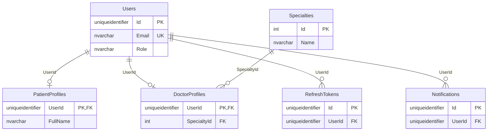
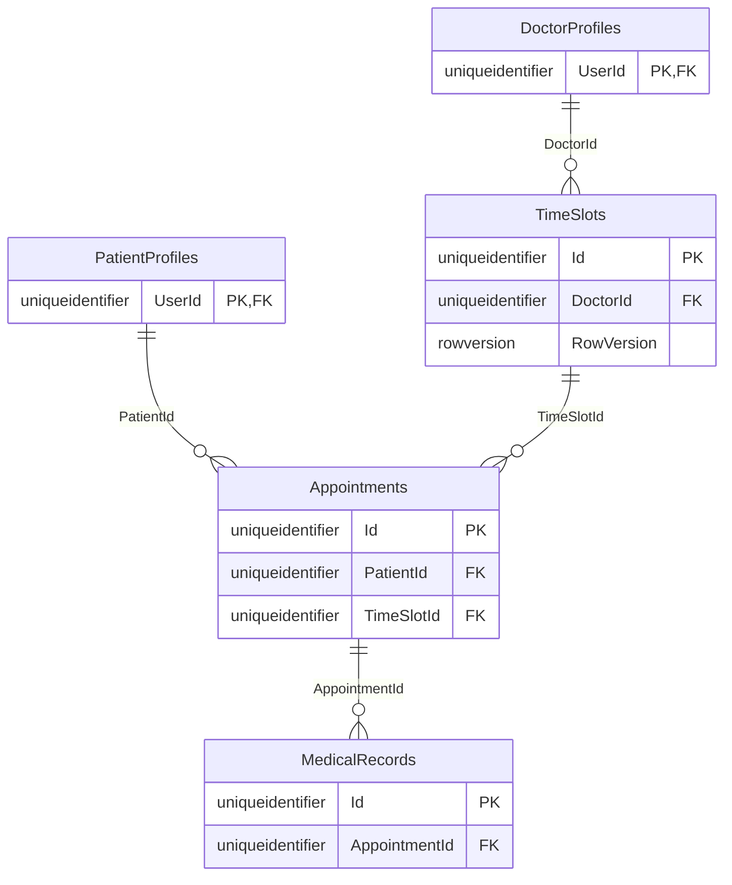
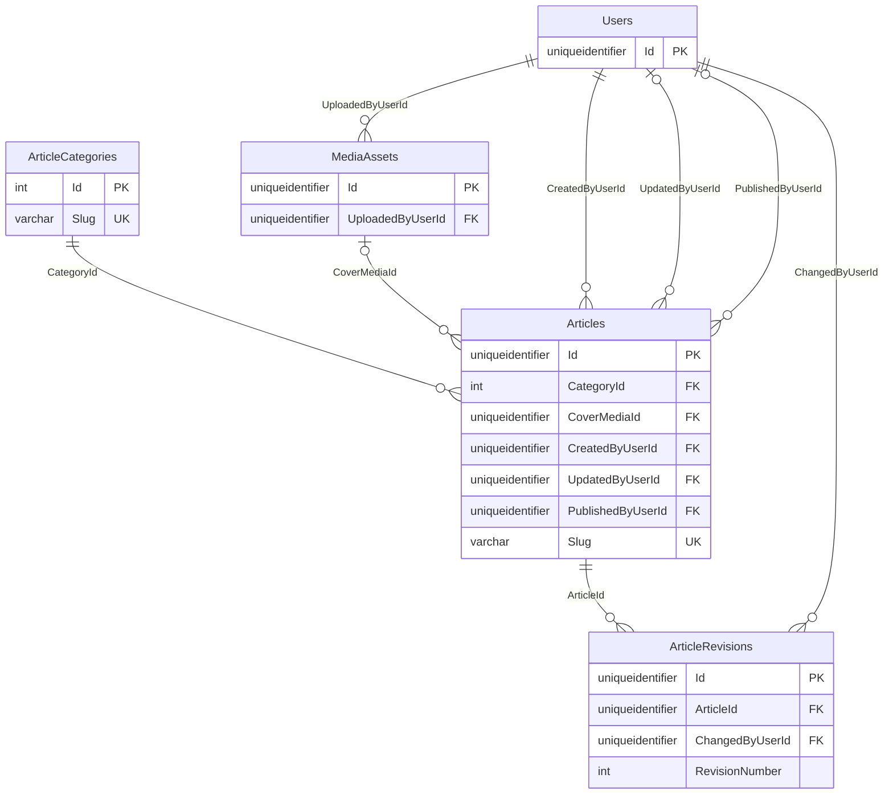

# Mô tả cơ sở dữ liệu SmartClinic hiện tại

Ngày đối chiếu: 03/11/2026.

Tài liệu mô tả **14 bảng hiện có trong sơ đồ người dùng cung cấp**, đối chiếu với Domain entities, `ApplicationDbContext` và script `20261103_article_management.sql`. Đây là mô hình hiện tại, chưa phải toàn bộ mô hình HIS đích trong kế hoạch phát triển.

Kiểu dữ liệu, độ dài và khả năng NULL của 10 bảng ban đầu được ghi theo EF mapping/entity hiện tại; những chuỗi chưa cấu hình độ dài được ghi theo quy ước EF SQL Server là `nvarchar(max)`. Cấu trúc 4 bảng bài viết được lấy trực tiếp từ script SQL đã cung cấp. Chưa truy vấn trực tiếp metadata database của người dùng; có thể dùng script `SmartClinic.Backend/database/inspect_current_schema.sql` để đối chiếu schema vật lý trước khi đưa vào báo cáo cuối cùng.

## 1. Vì sao các đường nối khóa ngoại trông rối?

Sơ đồ đang hiển thị đồng thời các nhóm tài khoản, đặt lịch/khám, bài viết và tri thức AI. `Users` là bảng trung tâm, được nhiều bảng tham chiếu. Riêng `Articles` có ba khóa ngoại khác nhau cùng trỏ tới `Users`:

| Khóa ngoại | Ý nghĩa |
|---|---|
| `Articles.CreatedByUserId → Users.Id` | Tài khoản tạo bài |
| `Articles.UpdatedByUserId → Users.Id` | Tài khoản sửa bài gần nhất |
| `Articles.PublishedByUserId → Users.Id` | Tài khoản xuất bản bài |

Ví dụ: Admin A tạo bản nháp, Admin B sửa nội dung, Admin C xuất bản. Ba cột ghi ba vai trò trong quy trình; chúng có thể cùng chứa một UserId khi một người làm cả ba việc. Đây là ba quan hệ có ý nghĩa khác nhau, không phải một khóa ngoại bị tạo thừa ba lần.

`MediaAssets.UploadedByUserId` và `ArticleRevisions.ChangedByUserId` cũng trỏ về `Users` để xác định người tải tệp và người tạo phiên bản chỉnh sửa. Các đường cắt nhau trên màn hình chỉ do bố trí hình học; giao điểm không tạo thêm quan hệ giữa các bảng.

SSMS thường vẽ đầu khóa ở phía bản ghi được tham chiếu và đầu nhiều ở phía bảng chứa FK. Muốn biết chính xác đường nào nối cột nào, phải đọc tên FK/cột, không chỉ nhìn vị trí đường đi. Quan hệ 1–1 cần thêm tính duy nhất ở FK; không thể suy ra chỉ từ tên bảng.

Nên trình bày bằng ba sơ đồ:

1. Tài khoản và hồ sơ: Users, PatientProfiles, DoctorProfiles, Specialties, RefreshTokens, Notifications.
2. Đặt lịch và bệnh án: PatientProfiles, DoctorProfiles, TimeSlots, Appointments, MedicalRecords.
3. Quản lý bài viết: Users, ArticleCategories, Articles, MediaAssets, ArticleRevisions.

`KnowledgeDocs` hiện chưa có FK nên có thể đặt riêng trong nhóm tri thức AI. Việc một bảng xuất hiện ở nhiều sơ đồ chỉ là nhiều góc nhìn của cùng database, không phải nhân bản bảng. Có thể chỉ hiển thị PK/FK trên sơ đồ tổng quan và đưa toàn bộ thuộc tính vào từ điển dữ liệu bên dưới. Không xóa FK chỉ để sơ đồ ít đường hơn.

## 2. Xác định thực thể

| Nhóm | Thực thể/bảng | Công dụng |
|---|---|---|
| Định danh | Users | Tài khoản đăng nhập, thông tin liên hệ và vai trò |
| Định danh | RefreshTokens | Dữ liệu phục vụ gia hạn phiên; chưa được luồng auth hiện tại sử dụng |
| Hồ sơ | PatientProfiles | Thông tin hành chính và sức khỏe nền của bệnh nhân |
| Hồ sơ | DoctorProfiles | Thông tin chuyên môn của tài khoản bác sĩ |
| Danh mục | Specialties | Danh mục chuyên khoa |
| Đặt lịch | TimeSlots | Các khung thời gian làm việc/nhận lịch của bác sĩ |
| Đặt lịch | Appointments | Lịch hẹn giữa bệnh nhân và khung giờ bác sĩ |
| Khám bệnh | MedicalRecords | Thông tin khám và kết luận gắn với lịch hẹn trong mô hình hiện tại |
| Thông báo | Notifications | Thông báo gửi tới tài khoản |
| Tri thức AI | KnowledgeDocs | Metadata tài liệu dùng cho kho tri thức AI |
| Nội dung | ArticleCategories | Chuyên mục phân loại bài viết |
| Nội dung | Articles | Nội dung hiện hành và thông tin xuất bản bài viết |
| Nội dung | MediaAssets | Metadata ảnh/tệp phục vụ bài viết |
| Nội dung | ArticleRevisions | Các bản chụp lịch sử chỉnh sửa của bài viết |

Admin, Patient và Doctor là các vai trò của tài khoản, không phải ba bảng Users riêng. Hồ sơ Patient/Doctor bổ sung thuộc tính chuyên biệt. Guest là người chưa đăng nhập, không cần có bản ghi Users. Vai trò Receptionist thuộc yêu cầu hệ thống nhưng chưa có hằng role/policy tương ứng trong backend đã đối chiếu.

## 3. Xác định các mối quan hệ

Quy ước: `1` là đúng một; `0..1` là không có hoặc có một; `0..N` là không có hoặc có nhiều. Cột “phía con” cho biết một dòng ở bảng con cần bao nhiêu dòng cha.

| STT | Bảng cha → bảng con | Cột FK ở bảng con | Một cha có | Một con tham chiếu |
|---|---|---|---|---|
| 1 | Users → PatientProfiles | UserId | 0..1 hồ sơ | 1 tài khoản |
| 2 | Users → DoctorProfiles | UserId | 0..1 hồ sơ | 1 tài khoản |
| 3 | Users → RefreshTokens | UserId | 0..N token | 1 tài khoản |
| 4 | Users → Notifications | UserId | 0..N thông báo | 1 tài khoản |
| 5 | Specialties → DoctorProfiles | SpecialtyId | 0..N bác sĩ | 1 chuyên khoa |
| 6 | DoctorProfiles → TimeSlots | DoctorId → DoctorProfiles.UserId | 0..N khung giờ | 1 bác sĩ |
| 7 | PatientProfiles → Appointments | PatientId → PatientProfiles.UserId | 0..N lịch hẹn | 1 bệnh nhân |
| 8 | TimeSlots → Appointments | TimeSlotId | 0..N lịch hẹn | 1 khung giờ |
| 9 | Appointments → MedicalRecords | AppointmentId | 0..N bệnh án | 1 lịch hẹn |
| 10 | ArticleCategories → Articles | CategoryId | 0..N bài viết | 1 chuyên mục |
| 11 | MediaAssets → Articles | CoverMediaId | 0..N bài dùng làm ảnh bìa | 0..1 ảnh bìa |
| 12 | Users → Articles | CreatedByUserId | 0..N bài đã tạo | 1 người tạo |
| 13 | Users → Articles | UpdatedByUserId | 0..N bài sửa gần nhất | 0..1 người sửa gần nhất |
| 14 | Users → Articles | PublishedByUserId | 0..N bài đã xuất bản | 0..1 người xuất bản |
| 15 | Users → MediaAssets | UploadedByUserId | 0..N tệp | 1 người tải |
| 16 | Articles → ArticleRevisions | ArticleId | 0..N phiên bản | 1 bài viết |
| 17 | Users → ArticleRevisions | ChangedByUserId | 0..N phiên bản | 1 người chỉnh sửa |

Các điểm cần đọc đúng:

- `PatientProfiles.UserId` và `DoctorProfiles.UserId` vừa là PK vừa là FK. Tính duy nhất của PK giới hạn mỗi tài khoản tối đa một hồ sơ ở mỗi bảng. Schema hiện chưa tự bảo đảm role của tài khoản khớp loại hồ sơ, cũng chưa cấm một User có cả hai loại hồ sơ; các quy tắc này cần Application kiểm soát.
- `Appointments.PatientId` hiện tham chiếu **PatientProfiles.UserId**, chưa phải một PatientProfileId độc lập.
- `TimeSlots.DoctorId` hiện tham chiếu **DoctorProfiles.UserId**.
- `MedicalRecords.AppointmentId` chưa có unique constraint trong mapping được đọc. Vì vậy mô hình vật lý hiện cho phép một lịch hẹn có nhiều bệnh án; không mô tả nó là 1–1.
- `Appointments.TimeSlotId` cũng chưa unique. `IsBooked` không tự giới hạn mỗi slot một lịch hẹn; phải có quy tắc đặt chỗ hoặc constraint bổ sung theo mô hình sức chứa được chọn.
- Mỗi bài thuộc đúng một chuyên mục, chưa có mô hình bài thuộc nhiều chuyên mục.
- `CoverMediaId` nullable để cho phép lưu nháp. Khi `Status = Published`, CHECK constraint yêu cầu có ảnh bìa.
- FK tới Users chỉ kiểm tra tài khoản tồn tại; không tự kiểm tra tài khoản đó có role Admin. API quản trị phải kiểm tra quyền.

## 4. Biểu đồ thực thể liên kết

Các hình dưới chỉ thể hiện PK/FK quan trọng để dễ đọc. Chúng mô tả các bảng hiện có, không đưa Visit hoặc ClinicalOrder chưa được tạo vào sơ đồ hiện trạng.

### 4.1. Tài khoản và hồ sơ

### 4.2. Đặt lịch và bệnh án hiện tại

### 4.3. Quản lý bài viết

`KnowledgeDocs` hiện là thực thể độc lập về FK. Quan hệ giữa tài liệu và vector ngoài SQL chưa được thể hiện bằng một bảng chunk hoặc vector mapping trong schema này.

## 5. Thiết kế chi tiết các bảng dữ liệu

Quy ước trong các bảng: **Không** ở cột NULL nghĩa là không được lưu SQL NULL; **Có** nghĩa là có thể để NULL. Không được NULL không đồng nghĩa tự động cấm chuỗi rỗng. `PK`: khóa chính; `FK`: khóa ngoại; `UQ`: duy nhất. Các thuộc tính navigation trong C# như `User`, `Appointments`, `MedicalRecords` không phải cột dữ liệu vật lý nên không liệt kê thành cột SQL.

### 5.1. Users — Tài khoản người dùng

**Công dụng:** lưu danh tính đăng nhập dùng chung cho các nhóm người dùng; là điểm tham chiếu cho hồ sơ và người thực hiện thao tác.

| Thuộc tính | Kiểu SQL theo mapping | NULL | Khóa/ràng buộc | Tác dụng |
|---|---|---|---|---|
| Id | uniqueidentifier | Không | PK; default NEWID() | Định danh tài khoản; được dùng làm claim định danh trong JWT và FK ở các bảng khác. |
| Email | nvarchar(255) | Không | UQ | Email đăng nhập; auth hiện chuẩn hóa trim/lowercase trước khi tạo tài khoản. |
| PhoneNumber | nvarchar(20) | Không | Chưa có UQ | Điện thoại liên hệ; không phải tên đăng nhập trong auth hiện tại. Có thể dùng chung giữa người thân. |
| PasswordHash | nvarchar(max) | Không | — | Giá trị băm mật khẩu; không lưu mật khẩu rõ. Code hiện dùng ASP.NET Core PasswordHasher. |
| Role | nvarchar(50) | Không | Chưa có CHECK enum trong mapping | Vai trò tài khoản. Backend hiện hỗ trợ Patient, Doctor, Admin. |
| DeviceToken | nvarchar(255) | Có | — | Định danh thiết bị phục vụ push notification khi tích hợp; không phải access JWT. Một cột này chưa mô hình hóa nhiều thiết bị trên một tài khoản. |

### 5.2. PatientProfiles — Hồ sơ bệnh nhân

**Công dụng:** lưu thông tin hành chính và sức khỏe nền gắn với tài khoản bệnh nhân. Dữ liệu này dùng chung cho các lần khám; chỉ số đo riêng của từng lượt khám nên nằm ở bệnh án/lượt khám khi phát triển module lâm sàng.

| Thuộc tính | Kiểu SQL theo mapping | NULL | Khóa/ràng buộc | Tác dụng |
|---|---|---|---|---|
| UserId | uniqueidentifier | Không | PK, FK → Users.Id | Định danh hồ sơ bằng chính ID tài khoản; hiện chưa cho phép hồ sơ không có tài khoản. |
| DOB | datetime | Có | — | Ngày sinh; API hồ sơ giao tiếp theo ngày, không dùng phần giờ cho nghiệp vụ. |
| FullName | nvarchar(100) | Có | — | Họ tên bệnh nhân. |
| Gender | nvarchar(20) | Có | — | Giới tính khai báo; API hiện nhận Nam, Nữ, Khác. |
| IdentityCard | nvarchar(20) | Có | Chưa có UQ | Số giấy tờ định danh/CCCD khai báo; giữ dạng chuỗi để không mất số 0 đầu. Chưa tự xác minh danh tính hoặc liên kết hồ sơ. |
| AvatarUrl | nvarchar(500) | Có | — | Đường dẫn ảnh đại diện; không phải dữ liệu nhị phân ảnh. |
| Occupation | nvarchar(255) | Có | — | Nghề nghiệp. |
| Ethnicity | nvarchar(100) | Có | — | Dân tộc được khai báo. |
| Address | nvarchar(500) | Có | — | Địa chỉ liên hệ/cư trú. |
| HealthInsuranceNumber | nvarchar(100) | Có | Chưa có UQ | Số thẻ/mã BHYT khai báo. |
| HealthInsuranceExpiry | datetime | Có | — | Ngày hết hạn BHYT, nếu được cung cấp. |
| EmergencyContactName | nvarchar(255) | Có | — | Họ tên người liên hệ khẩn cấp. |
| EmergencyContactPhone | nvarchar(50) | Có | — | Điện thoại người liên hệ khẩn cấp. |
| BloodType | nvarchar(10) | Có | — | Nhóm máu khai báo; không biết thì để trống hoặc Chưa rõ theo API. |
| Allergies | nvarchar(max) | Có | — | Nội dung khai báo dị ứng thuốc/thực phẩm và phản ứng liên quan. |
| BackgroundDisease | nvarchar(max) | Có | — | Bệnh nền và tiền sử liên quan; API hiện dùng tên MedicalHistory cho trường này. |
| HeightCm | decimal(6,2) | Có | — | Chiều cao tham khảo tính bằng cm; được thêm bằng script ngày 02/11/2026. |
| WeightKg | decimal(6,2) | Có | — | Cân nặng tham khảo tính bằng kg. |

Các trường hành chính có thể NULL ở SQL để hỗ trợ hồ sơ mới sau đăng ký. API hoàn thiện hồ sơ hiện bắt buộc họ tên, ngày sinh, giới tính, điện thoại, địa chỉ và ít nhất CCCD hoặc BHYT. **IsProfileCompleted hiện là giá trị tính trong service, không phải cột vật lý trong Users/PatientProfiles.** Hai tầng này không mâu thuẫn: SQL cho phép tồn tại hồ sơ chưa hoàn thiện, API kiểm tra điều kiện khi hoàn tất khai báo.

### 5.3. DoctorProfiles — Hồ sơ bác sĩ

**Công dụng:** bổ sung thông tin chuyên môn cho tài khoản bác sĩ.

| Thuộc tính | Kiểu SQL theo mapping | NULL | Khóa/ràng buộc | Tác dụng |
|---|---|---|---|---|
| UserId | uniqueidentifier | Không | PK, FK → Users.Id | ID hồ sơ bác sĩ, đồng thời là ID tài khoản. |
| SpecialtyId | int | Không | FK → Specialties.Id | Chuyên khoa chính của bác sĩ; hiện mỗi bác sĩ chỉ có một FK chuyên khoa. |
| Bio | nvarchar(max) | Có | — | Giới thiệu chuyên môn, kinh nghiệm hoặc năng lực. |
| ConsultationFee | decimal(18,2) | Có | Default 0 | Mức phí khám gắn với bác sĩ trong mô hình hiện tại. Chưa thay thế danh mục dịch vụ/bảng giá đầy đủ. |

Schema hiện chưa có cột họ tên bác sĩ riêng và Users cũng chưa có FullName. Không nên mô tả frontend đang lấy tên bác sĩ thật từ database này; phần tên bác sĩ hiện vẫn cần bổ sung mô hình hoặc nguồn dữ liệu phù hợp.

### 5.4. Specialties — Chuyên khoa

**Công dụng:** lưu danh mục chuyên khoa dùng để phân loại bác sĩ và hỗ trợ chọn chuyên khoa khám.

| Thuộc tính | Kiểu SQL theo mapping | NULL | Khóa/ràng buộc | Tác dụng |
|---|---|---|---|---|
| Id | int | Không | PK | Mã chuyên khoa; cơ chế IDENTITY thực tế cần đối chiếu database. |
| Name | nvarchar(255) | Không | — | Tên chuyên khoa, ví dụ Nội tổng hợp, Tim mạch. |
| Description | nvarchar(max) | Có | — | Mô tả phạm vi chuyên môn hoặc nội dung giới thiệu. |

### 5.5. TimeSlots — Khung giờ bác sĩ

**Công dụng:** biểu diễn một khoảng thời gian nhận lịch của bác sĩ.

| Thuộc tính | Kiểu SQL theo mapping | NULL | Khóa/ràng buộc | Tác dụng |
|---|---|---|---|---|
| Id | uniqueidentifier | Không | PK; default NEWID() | Mã khung giờ. |
| DoctorId | uniqueidentifier | Không | FK → DoctorProfiles.UserId | Bác sĩ phụ trách khung giờ. |
| StartTime | datetime | Không | — | Thời điểm bắt đầu. |
| EndTime | datetime | Không | — | Thời điểm kết thúc. |
| IsBooked | bit | Có | Default 0 | Cờ đánh dấu đã được đặt theo mô hình đơn giản hiện tại; không phải bộ đếm sức chứa. |
| RowVersion | rowversion | Không | Concurrency token | Giá trị nhị phân 8 byte SQL Server sinh khi bản ghi được thêm/cập nhật; dùng phát hiện cập nhật cạnh tranh. Đây không phải thời gian hoặc số phiên bản do người dùng nhập. |

Mapping hiện chưa có CHECK EndTime > StartTime, chưa có MaxCapacity/ReservedCount và chưa có use case chống đặt vượt chỗ. RowVersion chỉ có tác dụng khi thao tác đặt lịch thực sự kiểm tra/cập nhật bản ghi slot theo concurrency token.

### 5.6. Appointments — Lịch hẹn

**Công dụng:** ghi nhận việc bệnh nhân đặt trước một khung giờ khám.

| Thuộc tính | Kiểu SQL theo mapping | NULL | Khóa/ràng buộc | Tác dụng |
|---|---|---|---|---|
| Id | uniqueidentifier | Không | PK; default NEWID() | Mã lịch hẹn. |
| PatientId | uniqueidentifier | Không | FK → PatientProfiles.UserId | Hồ sơ bệnh nhân đặt lịch. |
| TimeSlotId | uniqueidentifier | Không | FK → TimeSlots.Id | Khung giờ đã chọn; thông qua slot xác định bác sĩ. |
| Status | nvarchar(50) | Không | Chưa có CHECK enum | Trạng thái lịch hẹn. Tập trạng thái/chuyển trạng thái cần được chuẩn hóa khi làm API; không mặc định coi trạng thái demo là constraint SQL. |
| Symptom | nvarchar(max) | Có | — | Triệu chứng hoặc lý do đặt khám do bệnh nhân khai báo. |
| AITriageSuggestion | nvarchar(max) | Có | — | Gợi ý tiền khám/phân luồng từ AI nếu có; không phải kết luận chuyên môn đã xác nhận. |
| PaymentStatus | nvarchar(50) | Có | — | Trạng thái thanh toán dự kiến. Hiện chưa có bảng hóa đơn/giao dịch để hình thành module thanh toán đầy đủ. |

### 5.7. MedicalRecords — Bệnh án trong mô hình hiện tại

**Công dụng:** lưu nội dung khám liên kết trực tiếp với lịch hẹn. Đây còn là mô hình đơn giản, chưa có lượt khám độc lập.

| Thuộc tính | Kiểu SQL theo mapping | NULL | Khóa/ràng buộc | Tác dụng |
|---|---|---|---|---|
| Id | uniqueidentifier | Không | PK; default NEWID() | Mã bệnh án. |
| AppointmentId | uniqueidentifier | Không | FK → Appointments.Id; chưa UQ | Lịch hẹn liên quan. Hiện không thể tạo bệnh án không có Appointment. |
| Diagnosis | nvarchar(max) | Không | — | Nội dung chẩn đoán. |
| ClinicalNotes | nvarchar(max) | Có | — | Ghi chú khám lâm sàng. |
| Prescription | nvarchar(max) | Có | — | Nội dung đơn thuốc dạng văn bản. Chưa có danh sách thuốc cấu trúc, liều, số lượng hoặc FK tới danh mục thuốc. |

### 5.8. RefreshTokens — Token gia hạn phiên

**Công dụng:** cấu trúc dự kiến lưu token dùng để xin access token mới. Bảng có trong database nhưng auth hiện chưa triển khai refresh/logout phía server.

| Thuộc tính | Kiểu SQL theo mapping | NULL | Khóa/ràng buộc | Tác dụng |
|---|---|---|---|---|
| Id | uniqueidentifier | Không | PK; default NEWID() | Mã bản ghi token. |
| UserId | uniqueidentifier | Không | FK → Users.Id | Chủ sở hữu token. |
| Token | nvarchar(255) | Không | Chưa có UQ trong mapping | Giá trị token theo schema hiện tại. Khi triển khai refresh nên lưu hash và bổ sung quy tắc rotation/revocation; chưa được mô tả là cơ chế đã có. |
| ExpiresAt | datetime | Không | — | Thời điểm hết hạn token. |

### 5.9. Notifications — Thông báo

**Công dụng:** lưu thông báo dành cho từng tài khoản và trạng thái đọc.

| Thuộc tính | Kiểu SQL theo mapping | NULL | Khóa/ràng buộc | Tác dụng |
|---|---|---|---|---|
| Id | uniqueidentifier | Không | PK; default NEWID() | Mã thông báo. |
| UserId | uniqueidentifier | Không | FK → Users.Id | Tài khoản nhận thông báo. |
| Title | nvarchar(255) | Không | — | Tiêu đề ngắn. |
| Message | nvarchar(max) | Không | — | Nội dung thông báo. |
| IsRead | bit | Có | Default 0 | Đã đọc hay chưa đọc; NULL vẫn được phép theo entity hiện tại. |
| CreatedAt | datetime | Có | Default GETDATE() | Thời điểm tạo theo giờ SQL Server hiện tại. Không tự coi là UTC. |

### 5.10. KnowledgeDocs — Tài liệu tri thức AI

**Công dụng:** lưu metadata tài liệu phục vụ xây dựng kho tri thức. Không thay thế bảng bài viết công khai.

| Thuộc tính | Kiểu SQL theo mapping | NULL | Khóa/ràng buộc | Tác dụng |
|---|---|---|---|---|
| Id | uniqueidentifier | Không | PK; default NEWID() | Mã tài liệu. |
| Title | nvarchar(500) | Không | — | Tên tài liệu. |
| FileUrl | nvarchar(max) | Không | — | Vị trí/đường dẫn tệp tài liệu. |
| UploadedAt | datetime | Có | Default GETDATE() | Thời điểm tải lên theo giờ SQL Server. |
| IsVectorized | bit | Có | Default 0 | Đánh dấu đã xử lý vector theo mô hình đơn giản; chưa có thông tin version/job/chunk hoặc trạng thái phê duyệt. |

### 5.11. ArticleCategories — Chuyên mục bài viết

**Công dụng:** quản lý danh mục chuyên mục; hỗ trợ lọc bài và sắp xếp menu chuyên mục.

| Thuộc tính | Kiểu SQL trong script | NULL | Khóa/ràng buộc | Tác dụng |
|---|---|---|---|---|
| Id | int | Không | PK, IDENTITY(1,1) | Mã chuyên mục tự tăng. |
| Name | nvarchar(150) | Không | CHECK không rỗng sau trim | Tên hiển thị của chuyên mục. |
| Slug | varchar(180) | Không | UQ; CHECK không rỗng | Định danh thân thiện dùng trong đường dẫn, ví dụ suc-khoe-cong-dong. Backend cần tạo/kiểm tra định dạng slug. |
| Description | nvarchar(500) | Có | — | Giới thiệu ngắn chuyên mục. |
| SortOrder | int | Không | Default 0 | Thứ tự hiển thị; ứng dụng có thể sắp tăng dần rồi theo Id để ổn định. |
| IsActive | bit | Không | Default 1 | Bật/tắt sử dụng chuyên mục. Việc ẩn bài thuộc chuyên mục tắt cần được API quy định, không tự xảy ra ở SQL. |
| CreatedAtUtc | datetime2(3) | Không | Default SYSUTCDATETIME() | Thời điểm tạo theo UTC, độ chính xác mili giây. |

### 5.12. MediaAssets — Tệp phục vụ nội dung bài viết

**Công dụng:** lưu thông tin quản lý tệp ảnh/tệp nội dung. Dữ liệu nhị phân nằm trong filesystem/object storage; bảng này không lưu ảnh trực tiếp.

| Thuộc tính | Kiểu SQL trong script | NULL | Khóa/ràng buộc | Tác dụng |
|---|---|---|---|---|
| Id | uniqueidentifier | Không | PK; default NEWSEQUENTIALID() | Mã tệp để bài viết tham chiếu. |
| StorageKey | nvarchar(500) | Không | CHECK không rỗng | Khóa/đường dẫn tương đối trong storage, ví dụ articles/2026/cover-abc.jpg; không nên lưu URL ký sẵn sắp hết hạn. |
| OriginalFileName | nvarchar(255) | Không | — | Tên gốc của tệp khi upload; không dùng trực tiếp để quyết định đường dẫn ghi file. |
| ContentType | varchar(100) | Không | — | MIME type, ví dụ image/jpeg, image/png. Backend phải kiểm tra loại tệp thực tế khi upload. |
| SizeBytes | bigint | Không | CHECK > 0 | Dung lượng tính bằng byte. |
| AltText | nvarchar(300) | Có | — | Nội dung mô tả thay thế cho ảnh khi hiển thị trên web. |
| UploadedByUserId | uniqueidentifier | Không | FK → Users.Id | Tài khoản tải tệp lên. |
| CreatedAtUtc | datetime2(3) | Không | Default SYSUTCDATETIME() | Thời điểm tạo metadata tệp. |

Một ảnh có thể làm ảnh bìa cho nhiều bài vì CoverMediaId không unique. Schema hiện chỉ có FK tường minh cho ảnh bìa; các ảnh nhúng bên trong ContentHtml chưa có bảng liên kết ArticleMedia. Vì vậy không được suy ra một tệp “không còn dùng” chỉ từ việc không có bài nào tham chiếu nó bằng CoverMediaId. Tệp bệnh án cần cơ chế truy cập riêng, không mặc định dùng quyền công khai của ảnh bài viết.

### 5.13. Articles — Bài viết

**Công dụng:** lưu phiên bản nội dung hiện hành của bài viết, thông tin hiển thị công khai và các dấu vết người tạo/sửa/xuất bản.

| Thuộc tính | Kiểu SQL trong script | NULL | Khóa/ràng buộc | Tác dụng |
|---|---|---|---|---|
| Id | uniqueidentifier | Không | PK; default NEWSEQUENTIALID() | Mã bài viết ổn định dù tiêu đề hoặc slug thay đổi. |
| CategoryId | int | Không | FK → ArticleCategories.Id | Chuyên mục của bài. |
| Title | nvarchar(300) | Không | CHECK không rỗng | Tiêu đề hiển thị trên thẻ bài và trang chi tiết. |
| Slug | varchar(350) | Không | UQ; CHECK không rỗng | Định danh URL, ví dụ /bai-viet/chuan-bi-truoc-khi-kham. |
| Summary | nvarchar(1000) | Có | Bắt buộc có nội dung khi Published | Mô tả ngắn trên danh sách bài viết. |
| ContentHtml | nvarchar(max) | Có | Bắt buộc có nội dung khi Published | Nội dung chi tiết định dạng HTML. Phải được lọc an toàn ở backend; CHECK SQL chỉ kiểm tra có nội dung, không lọc script. |
| CoverMediaId | uniqueidentifier | Có | FK → MediaAssets.Id; bắt buộc khi Published | Ảnh đại diện của bài. |
| AuthorDisplayName | nvarchar(200) | Có | — | Tên tác giả/đơn vị chuyên môn hiển thị cho độc giả; có thể khác tài khoản nhập bài. |
| Status | varchar(20) | Không | Default Draft; CHECK Draft/Published/Archived | Trạng thái lưu nháp, xuất bản hoặc lưu trữ/gỡ khỏi công khai. |
| IsFeatured | bit | Không | Default 0 | Đánh dấu bài nổi bật; truy vấn trang chủ vẫn phải lọc Published. |
| ViewsCount | bigint | Không | Default 0; CHECK >= 0 | Bộ đếm lượt xem; cần API/job tăng số lượt, không tự tăng khi SELECT. |
| SeoTitle | nvarchar(160) | Có | — | Tiêu đề dùng cho metadata SEO; có thể dùng Title nếu không khai báo. |
| SeoDescription | nvarchar(320) | Có | — | Mô tả dùng cho metadata SEO; không bảo đảm công cụ tìm kiếm sẽ hiển thị nguyên văn. |
| CreatedByUserId | uniqueidentifier | Không | FK → Users.Id | Người tạo bản ghi bài viết. |
| UpdatedByUserId | uniqueidentifier | Có | FK → Users.Id | Người chỉnh sửa gần nhất; không lưu được toàn bộ lịch sử một mình. |
| PublishedByUserId | uniqueidentifier | Có | FK → Users.Id; bắt buộc khi Published | Người thực hiện xuất bản. |
| CreatedAtUtc | datetime2(3) | Không | Default SYSUTCDATETIME() | Thời điểm tạo bản ghi bài. |
| UpdatedAtUtc | datetime2(3) | Có | Chưa có trigger tự cập nhật | Thời điểm sửa gần nhất, được use case cập nhật. |
| PublishedAtUtc | datetime2(3) | Có | Bắt buộc khi Published | Thời điểm xuất bản; dùng sắp xếp và hiển thị ngày đăng. |
| RowVersion | rowversion | Không | SQL Server tự sinh | Kiểm tra hai người sửa cùng phiên bản. Client gửi phiên bản đã đọc; backend trả xung đột nếu dữ liệu đã đổi. |

RowVersion cũng thay đổi khi tăng ViewsCount trên cùng hàng; khi triển khai cần tránh để cập nhật bộ đếm gây xung đột biên tập quá thường xuyên, chẳng hạn tách bộ đếm nếu lưu lượng tăng.

Các index đã được script tạo: unique Slug; danh sách theo Status/PublishedAtUtc/Id; danh sách theo CategoryId/Status/PublishedAtUtc/Id; index CoverMediaId và CreatedByUserId. Chúng phục vụ URL duy nhất, lọc bài công khai, phân trang và tra cứu quan hệ.

### 5.14. ArticleRevisions — Lịch sử bài viết

**Công dụng:** lưu từng bản chụp nội dung và metadata để xem lại, so sánh hoặc khôi phục khi xây dựng chức năng quản trị.

| Thuộc tính | Kiểu SQL trong script | NULL | Khóa/ràng buộc | Tác dụng |
|---|---|---|---|---|
| Id | uniqueidentifier | Không | PK; default NEWSEQUENTIALID() | Mã bản ghi lịch sử. |
| ArticleId | uniqueidentifier | Không | FK → Articles.Id | Bài viết mà phiên bản thuộc về. |
| RevisionNumber | int | Không | CHECK > 0; UQ cùng ArticleId | Số thứ tự phiên bản của từng bài, ví dụ 1, 2, 3. Chưa có cơ chế tự cấp số trong SQL script. |
| SnapshotJson | nvarchar(max) | Không | CHECK ISJSON(...) = 1 | Bản chụp nội dung/metadata ở dạng JSON. ISJSON chỉ bảo đảm JSON hợp lệ, không bảo đảm đủ các trường nghiệp vụ. |
| ChangedByUserId | uniqueidentifier | Không | FK → Users.Id | Người thực hiện chỉnh sửa tạo ra phiên bản này. |
| ChangedAtUtc | datetime2(3) | Không | Default SYSUTCDATETIME() | Thời điểm ghi phiên bản. |
| ChangeNote | nvarchar(500) | Có | — | Ghi chú hoặc lý do thay đổi. |

Unique `(ArticleId, RevisionNumber)` ngăn một bài có hai bản cùng số phiên bản. API phải lưu cập nhật bài và revision trong cùng transaction, cấp số phiên bản có kiểm soát cạnh tranh. Bảng lịch sử không tự được điền khi sửa Articles: script hiện chưa có trigger hay service thực hiện việc đó. Nó cũng chưa tự bất biến nếu tài khoản database vẫn có quyền UPDATE/DELETE.

## 6. Quy tắc toàn vẹn và vận hành cần phân biệt

### 6.1. Các ràng buộc đã thể hiện trong schema

- PK định danh duy nhất từng dòng.
- FK bảo đảm ID cha được tham chiếu tồn tại.
- Hai profile dùng shared PK/FK với Users.
- Email tài khoản, slug chuyên mục và slug bài viết có ràng buộc duy nhất.
- Script CMS có CHECK trạng thái, lượt xem, dung lượng, số revision, JSON và dữ liệu tối thiểu khi xuất bản.
- Các FK CMS không dùng ON DELETE CASCADE; khi còn dữ liệu tham chiếu, thao tác xóa bản ghi cha bị chặn. Các quan hệ cũ trong mapping cũng không cấu hình cascade delete database.

Ví dụ: không xóa User đang là người tạo bài mà vẫn giữ nguyên FK CreatedByUserId. Quy trình vận hành thường giữ tài khoản phục vụ lịch sử và xử lý khóa/ngừng hoạt động bằng chức năng quản trị khi có.

### 6.2. Những việc database không tự thực hiện

- FK không kiểm tra quyền Admin/Doctor/Patient hoặc quyền truy cập từng bệnh án.
- Cột UpdatedAtUtc không tự đổi khi UPDATE nếu use case không gán.
- ArticleRevisions không tự sinh khi sửa bài.
- IsFeatured không tự đưa một bài nháp lên trang chủ.
- IsVectorized không tự lập chỉ mục Pinecone.
- DeviceToken không tự gửi push notification.
- RowVersion không tự triển khai transaction đặt lịch hoặc cơ chế giải quyết xung đột.
- Giới hạn nullable ở database khác với quy tắc “hồ sơ hoàn thiện” ở Application.

Thời gian CMS dùng UTC, còn Notifications.CreatedAt và KnowledgeDocs.UploadedAt hiện có default GETDATE(). Khi nối frontend phải phân biệt hai quy ước và thống nhất dần, không tự đổi múi giờ dữ liệu cũ khi chưa biết nguồn.

## 7. Khoảng cách giữa schema hiện tại và thiết kế hệ thống mục tiêu

Sơ đồ rối chủ yếu do cách bố trí. Tuy nhiên, schema hiện tại thực sự còn thiếu các cấu trúc đã thống nhất trong kế hoạch:

| Hiện tại | Hạn chế | Hướng phát triển đã đề cập |
|---|---|---|
| PatientProfiles lấy UserId làm PK bắt buộc | Chưa tạo được hồ sơ walk-in chưa có tài khoản | Id riêng, UserId nullable; migration giữ lịch sử |
| MedicalRecords bắt buộc AppointmentId | Chưa lưu được bệnh án của Visit độc lập lịch hẹn | Thêm Visits; bệnh án gắn VisitId |
| MedicalRecords có quan hệ N với Appointment | Chưa bảo đảm một bệnh án chính cho một lượt khám | Thiết kế unique VisitId khi triển khai mô hình mới |
| TimeSlots chỉ có IsBooked | Chưa biểu diễn công suất nhiều bệnh nhân/slot | Capacity, số chỗ, transaction và concurrency test |
| Prescription là một chuỗi trong MedicalRecords | Chưa quản lý thuốc/liều/số lượng có cấu trúc | Medicines, Prescriptions, PrescriptionItems |
| Chưa có ClinicalOrders/Results | Chưa lưu điều phối liên khoa và file kết quả | Thêm các thực thể chỉ định/kết quả/đính kèm |
| KnowledgeDocs chỉ có IsVectorized | Chưa quản lý phê duyệt, phiên bản và hiệu lực tri thức | Vòng đời tài liệu, chunks và job index |
| Chưa có AuditLogs | Chưa có kiểm toán toàn bộ nghiệp vụ y tế | Audit và cơ chế hiệu chỉnh có kiểm soát |
| CMS có schema, frontend vẫn demo | Chưa có API bài viết thật | Xây use case/API, upload, xuất bản và nối PWA |

Các hướng này là phần chưa triển khai, không phải các bảng đang tồn tại trong ảnh. Tài liệu này chỉ mô tả và giải thích schema; không thay đổi FK hay cấu trúc database.
